<div align="center">

# MARKETING ANALYTICS
## E-commerce Revenue & Customer Cohort Analysis

**Google Sheets · Data Preparation · Marketing Measurement · Cohort Analytics**

<br/>


**Course:** DS 4115 — Marketing Analytics  
**Student:** `Musfique Ahmed` · **ID:** `0152330101` · **Section:** `BA`  

</div>

---

> **Report purpose**  
> This report documents how raw e-commerce transaction records were transformed into an analysis-ready marketing dataset, enriched with product and acquisition information, summarized by customer acquisition cohort, and made interactive through a Google Sheets Pivot Table and slicers.

## Contents

- [1. Executive summary](#1-executive-summary)
- [2. Analytical objectives](#2-analytical-objectives)
- [3. Workbook architecture](#3-workbook-architecture)
- [4. End-to-end workflow](#4-end-to-end-workflow)
- [5. Implementation and rationale](#5-implementation-and-rationale)
  - [5.1 Import transaction data](#51-import-transaction-data)
  - [5.2 Enrich transactions with product price](#52-enrich-transactions-with-product-price)
  - [5.3 Calculate gross revenue](#53-calculate-gross-revenue)
  - [5.4 Build customer cohorts](#54-build-customer-cohorts)
  - [5.5 Calculate channel CAC](#55-calculate-channel-cac)
  - [5.6 Build the Pivot Table](#56-build-the-pivot-table)
  - [5.7 Add interactive slicers](#57-add-interactive-slicers)
- [6. Findings and interpretation](#6-findings-and-interpretation)
- [7. Data-quality considerations and limitations](#7-data-quality-considerations-and-limitations)
- [8. Conclusion and next steps](#8-conclusion-and-next-steps)
- [Appendix A — Formula reference](#appendix-a--formula-reference)
- [Appendix B — Evidence index](#appendix-b--evidence-index)

---

## 1. Executive summary

This assignment develops a compact marketing analytics workflow in Google Sheets using transaction, product, customer, and marketing-spend data. The work moves from raw CSV ingestion to a structured analytical view.

The transaction data was enriched with **unit price**, **gross revenue**, **customer cohort month**, and **channel-level customer acquisition cost (CAC)**. A Pivot Table was then configured to summarize gross revenue by cohort month and acquisition channel. Transaction count and average transaction revenue were added to provide volume and ticket-size context. Finally, slicers were added for acquisition channel and cohort month.

### What the workflow produces

| Analytical output | Business question it helps answer |
|---|---|
| Unit price lookup | What is the listed price of each purchased product? |
| Gross revenue | What is the transaction's gross sales value? |
| First purchase date | When was each customer's first observed purchase? |
| Cohort month | In which month was each customer first observed? |
| Channel CAC | How much marketing spend was used per newly acquired customer in each channel? |
| Cohort × channel Pivot Table | How is gross revenue distributed across acquisition cohorts and channels? |
| Slicers | How does the summary change when a channel or cohort is isolated? |

<details>
<summary><strong>Key takeaway</strong></summary>

The workbook turns transaction-level records into a cohort-aware marketing performance view. It supports descriptive comparisons of acquisition cost, revenue, transaction volume, and cohort contribution. It does **not**, by itself, establish causal marketing impact or customer profitability.

</details>

## 2. Analytical objectives

1. Import the transaction CSV into the existing Google Sheets workbook while preserving other sheets.
2. Join product reference data to transactions using Product ID.
3. calculate transaction-level gross revenue from units sold and unit price.
4. Derive each customer's earliest observed purchase date.
5. Assign each customer to a monthly acquisition cohort.
6. Map the cohort month back to every transaction made by that customer.
7. Calculate CAC for each acquisition channel from marketing spend and new customers acquired.
8. Summarize gross revenue, transaction count, and average transaction revenue by cohort and channel.
9. Add slicers to support interactive exploration of the Pivot Table.

## 3. Workbook architecture

The workbook uses separate sheets for transaction facts and reference/derived data.

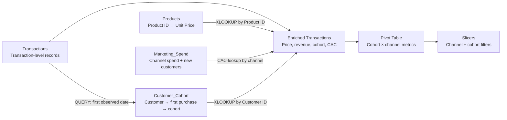

### Sheet responsibilities

| Sheet | Grain / role | Important fields |
|---|---|---|
| `Transactions` | One row per transaction | Transaction ID, Customer ID, Date, Product ID, Units Sold, Acquisition Channel |
| `Products` | One row per product | Product ID, Unit Price |
| `Marketing_Spend` | One row per acquisition channel | Acquisition Channel, Total Spend, New Customers Acquired, CAC |
| `Customer_Cohort` | One row per customer | Customer ID, First Purchase Date, Cohort Month |
| `Pivot Table` | Aggregated analytical output | Cohort Month, Acquisition Channel, Gross Revenue, transaction count, average revenue |

**Data-grain note:** `Transactions` is the fact table. `Products` and `Marketing_Spend` provide lookup attributes. `Customer_Cohort` is a derived customer-level table. The cohort assignment is calculated once per customer and then mapped onto all of that customer's transactions.

## 4. End-to-end workflow

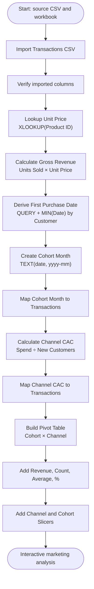

The sequence is intentional: the Pivot Table is built only after the transaction table contains the attributes required for cohort and channel analysis.

## 5. Implementation and rationale

### 5.1 Import transaction data

**Action.** Opened **File → Import**, uploaded the transaction CSV, selected **Insert new sheet(s)**, and imported the data.

**Why.** Importing into a new sheet preserves the workbook's existing reference sheets and avoids overwriting prior work. The imported table was checked to confirm that the expected fields were separated into columns.

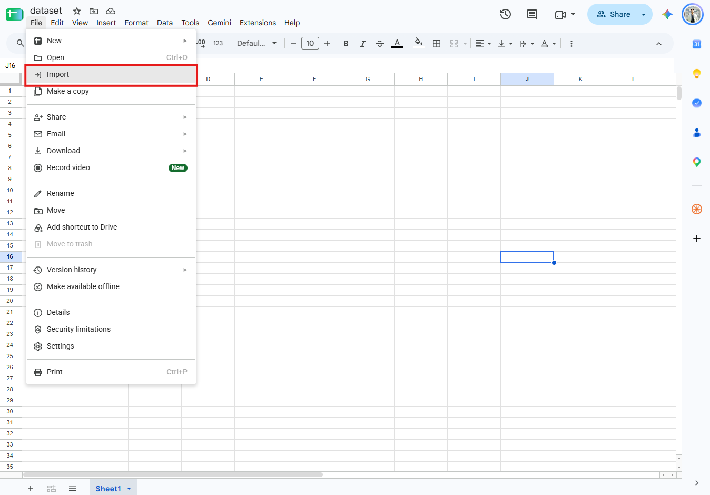

*Figure 1. Starting the CSV import through File → Import.*

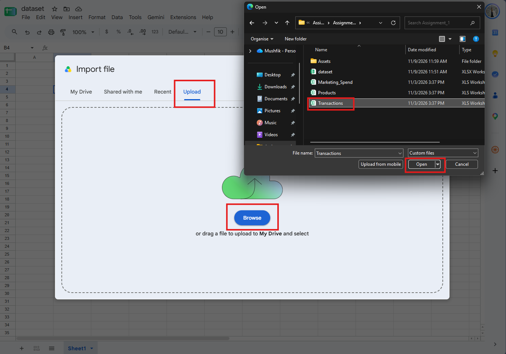

*Figure 2. Selecting the local Transactions CSV file.*

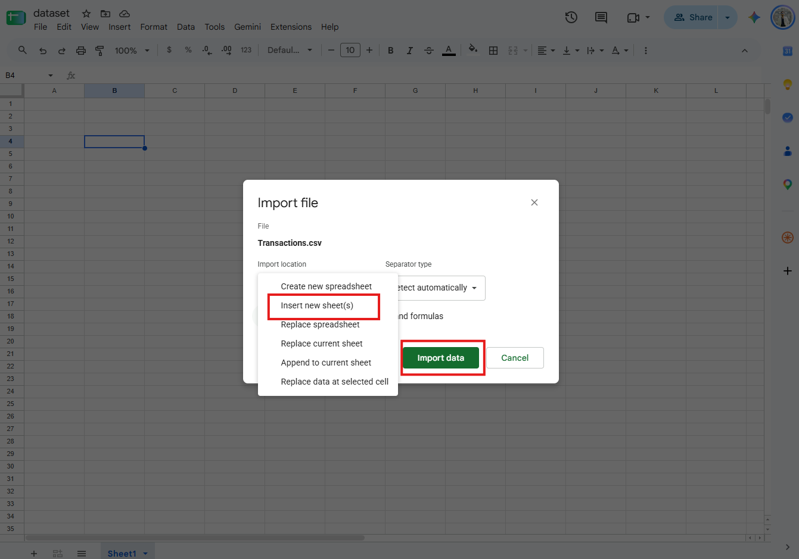

*Figure 3. Selecting Insert new sheet(s) to preserve the workbook's existing sheets.*

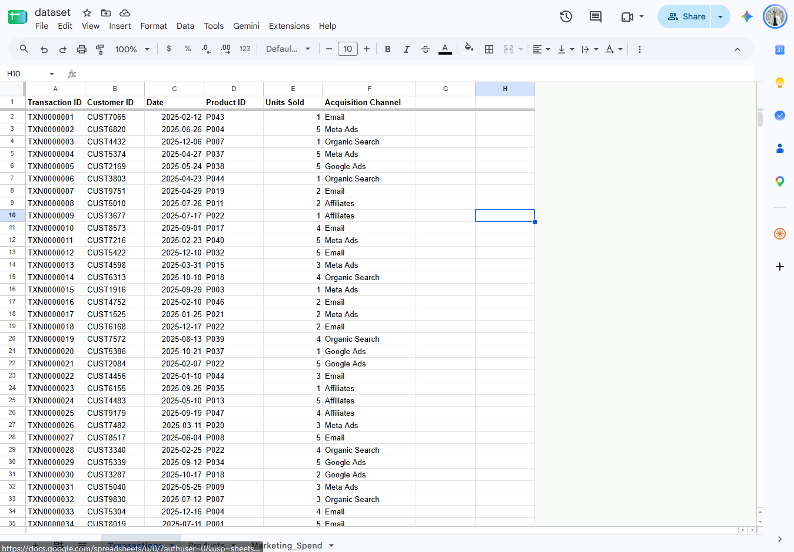

*Figure 4. Verifying the imported transaction fields.*

**Validation performed:** the visible transaction sheet contains Transaction ID, Customer ID, Date, Product ID, Units Sold, and Acquisition Channel.

### 5.2 Enrich transactions with product price

**Action.** Added a `Unit Price` field to `Transactions` and used `XLOOKUP` to retrieve the matching product price from `Products`.

```excel
=XLOOKUP(D2, Products!$A$2:$A$51, Products!$C$2:$C$51, 0)
```

| Argument | Meaning |
|---|---|
| `D2` | Product ID in the current transaction |
| `Products!$A$2:$A$51` | Product ID lookup range |
| `Products!$C$2:$C$51` | Unit price return range |
| `0` | Value returned if no match is found |

**Why.** The transaction sheet contains product identifiers, not necessarily the corresponding product prices. The lookup enriches each transaction with the product's unit price and avoids manual matching.

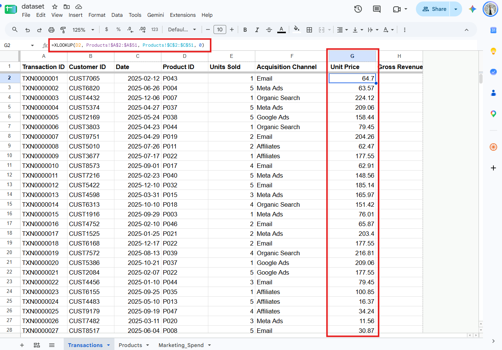

*Figure 5. Retrieving unit price by Product ID.*

### 5.3 Calculate gross revenue

**Action.** Added `Gross Revenue` and multiplied quantity by unit price.

```excel
=E2*G2
```

\[
\text{Gross Revenue}_i = \text{Units Sold}_i \times \text{Unit Price}_i
\]

**Example:** 5 units × 63.57 = 317.85.

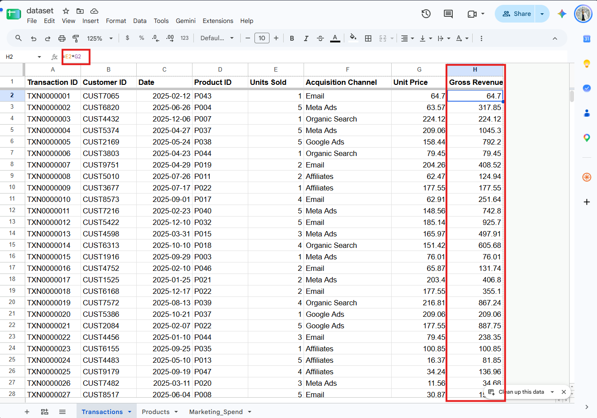

*Figure 6. Calculating transaction-level gross revenue.*

**Why.** Unit price does not represent the total value of a transaction when multiple units are purchased. Gross revenue provides the transaction value needed for aggregation.

> **Metric definition:** Gross revenue is not profit. This calculation does not deduct product costs, discounts, advertising spend, refunds, taxes, or fulfilment expenses.

### 5.4 Build customer cohorts

Customer cohort analysis groups customers according to the month of their first observed purchase. The workflow uses three operations.

#### Step 1 — Find each customer's first observed purchase

A `Customer_Cohort` sheet was created. `QUERY` groups the transaction records by Customer ID and calculates the minimum transaction date for each customer.

Conceptually:

```sql
SELECT
  Customer_ID,
  MIN(Transaction_Date) AS First_Purchase_Date
FROM Transactions
WHERE Customer_ID IS NOT NULL
GROUP BY Customer_ID;
```

The Google Sheets `QUERY` formula shown in the screenshot performs this grouping and minimum-date calculation.

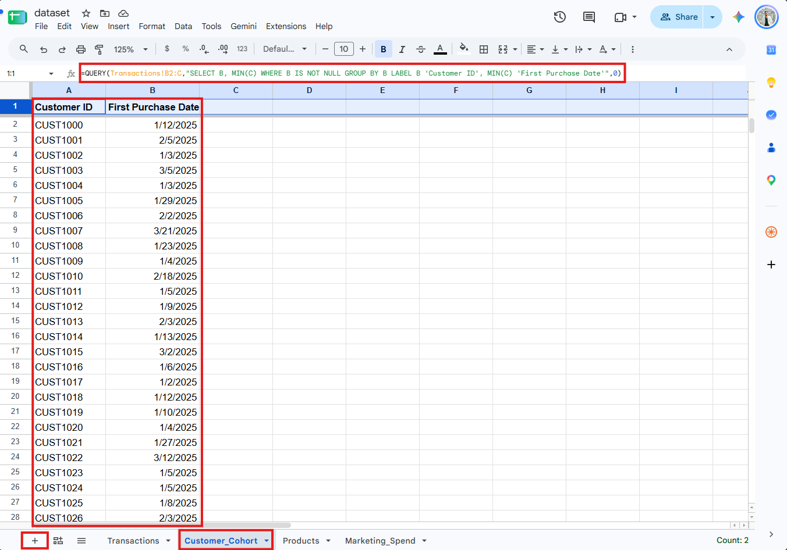

*Figure 7. Deriving one first-purchase date per customer.*

**Why.** A customer can make multiple purchases. Cohort membership should be based on the customer's first observed purchase, not on every subsequent transaction date.

#### Step 2 — Convert the date into a cohort month

```excel
=TEXT(B2, "yyyy-mm")
```

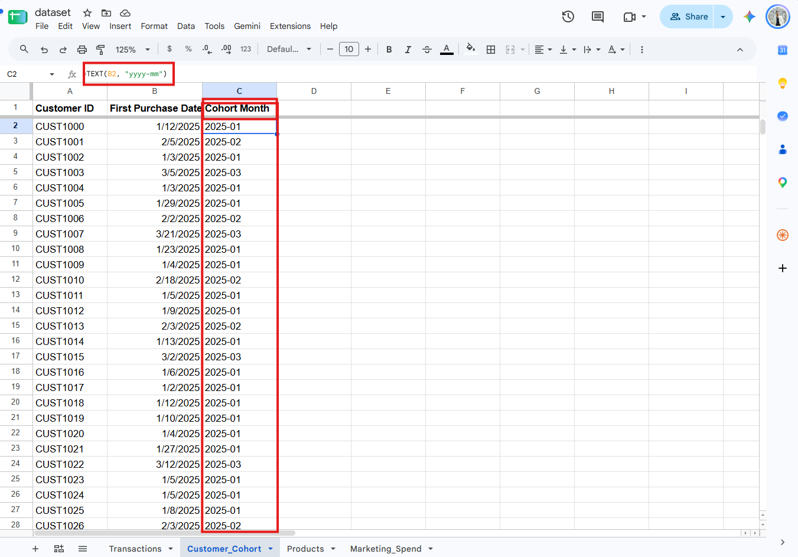

*Figure 8. Converting first-purchase dates into year-month cohort labels.*

**Why.** Monthly cohorts are easier to compare and align with typical monthly marketing reporting. For example, a first purchase in February 2025 becomes `2025-02`.

#### Step 3 — Map cohort month back to transactions

```excel
=XLOOKUP(B2, Customer_Cohort!$A$2:$A, Customer_Cohort!$C$2:$C, "")
```

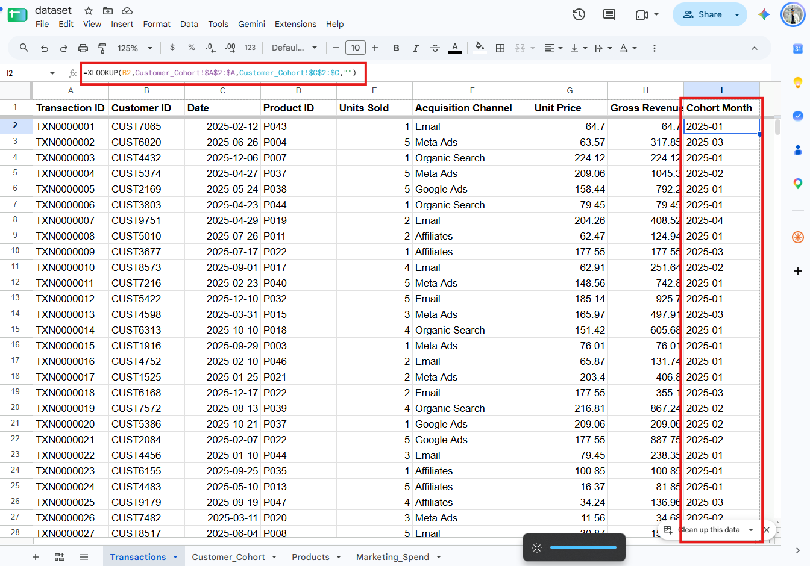

*Figure 9. Assigning each transaction its customer's cohort month.*

**Why.** Once cohort month is attached to each transaction, transaction revenue can be aggregated by the month in which the customer was first acquired. Repeat purchases remain associated with the original cohort.

### 5.5 Calculate channel CAC

**Action.** In `Marketing_Spend`, calculated CAC for each acquisition channel:

```excel
=B2/C2
```

\[
\text{CAC}_{channel} =
\frac{\text{Total Marketing Spend}_{channel}}
{\text{New Customers Acquired}_{channel}}
\]

The screenshot shows these values:

| Acquisition channel | Displayed CAC |
|---|---:|
| Google Ads | $20.83 |
| Meta Ads | $20.00 |
| Organic Search | $6.25 |
| Email | $11.11 |
| Affiliates | $13.64 |

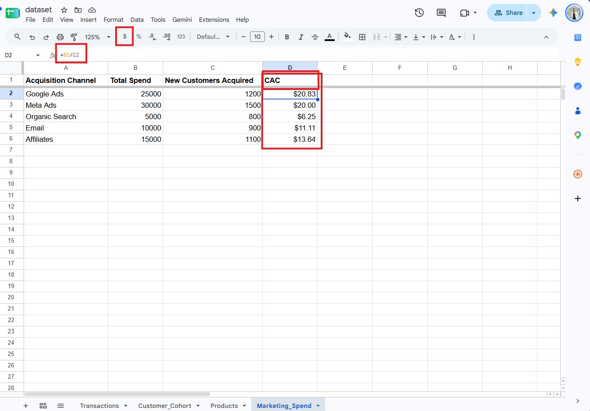

*Figure 10. Calculating acquisition cost per new customer by channel.*

**Why.** CAC expresses channel spend on a per-new-customer basis, enabling a first-pass comparison of acquisition efficiency.

The channel CAC was then mapped onto each transaction:

```excel
=XLOOKUP(F2, Marketing_Spend!$A$2:$A$6, Marketing_Spend!$D$2:$D$6, 0)
```

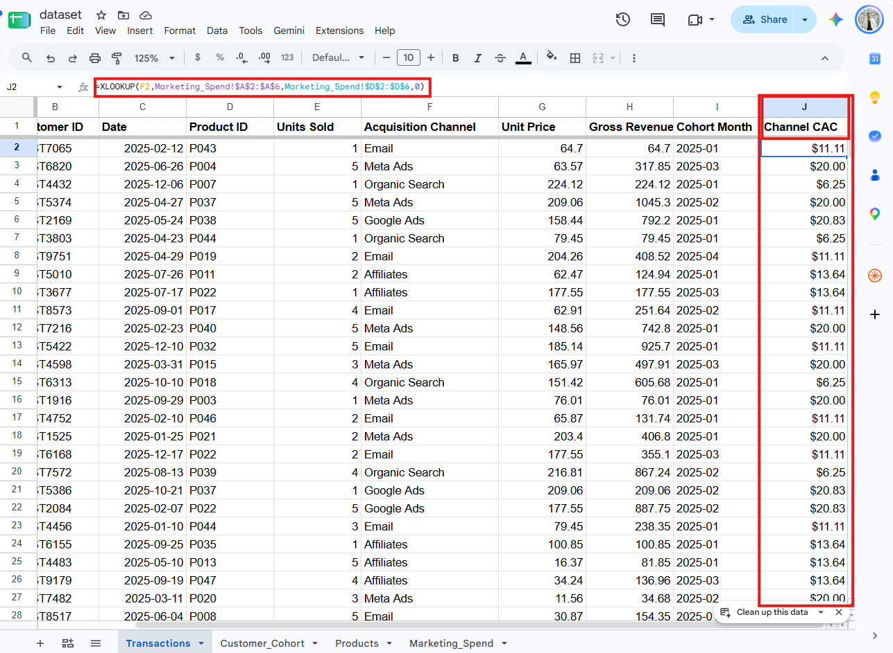

*Figure 11. Attaching the channel-level CAC to each transaction.*

> **Important interpretation:** This lookup repeats the same channel-level CAC across transactions from that channel. It does not calculate a unique acquisition cost for each transaction. Do not sum the repeated CAC values across transaction rows.

### 5.6 Build the Pivot Table

**Action.** Created a Pivot Table using the enriched `Transactions` data.

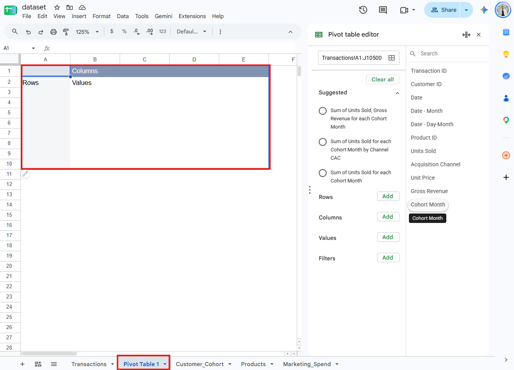

*Figure 12. Creating a Pivot Table from the transaction data.*

#### Pivot Table configuration

| Pivot area | Field | Aggregation / purpose |
|---|---|---|
| Rows | Cohort Month | Groups transactions by customer acquisition month |
| Columns | Acquisition Channel | Compares channels side by side |
| Values | Gross Revenue | `SUM` — total gross revenue |
| Values | Transaction ID | `COUNTA` — transaction count |
| Values | Gross Revenue | `AVERAGE` — average transaction revenue |
| Values | Gross Revenue (additional value) | Show as percentage of column total |

The first configuration summarizes revenue by cohort and channel:

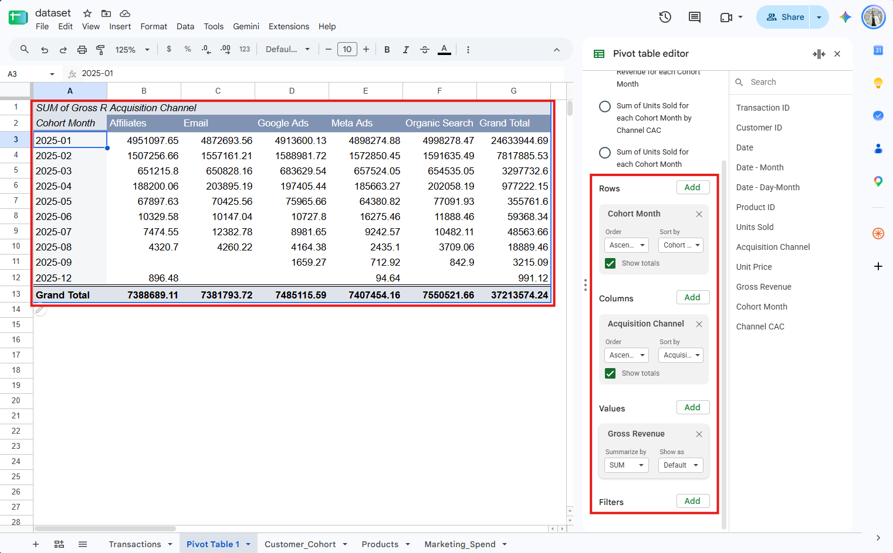

*Figure 13. Pivot Table with cohort months as rows, channels as columns, and summed gross revenue.*

The next configuration adds transaction count and average transaction revenue:

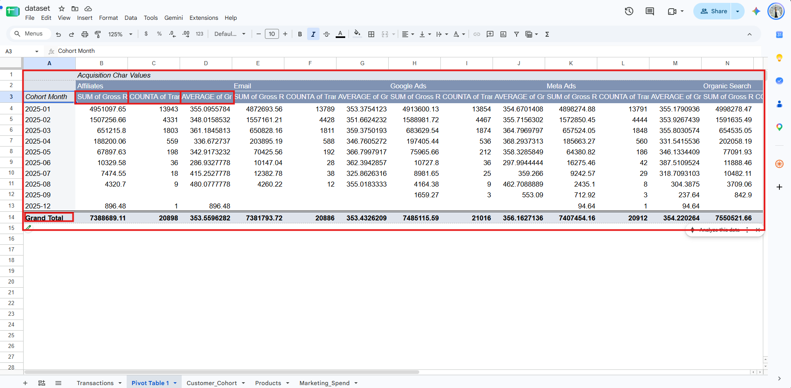

*Figure 14. Adding transaction volume and average transaction revenue.*

**Why these metrics matter:**

- **Sum of Gross Revenue:** measures the scale of sales value.
- **Count of Transaction ID:** indicates transaction volume.
- **Average of Gross Revenue:** indicates average transaction value, also known as average order value when each transaction represents one order.

The final value configuration displays gross revenue as a percentage of each channel's column total:

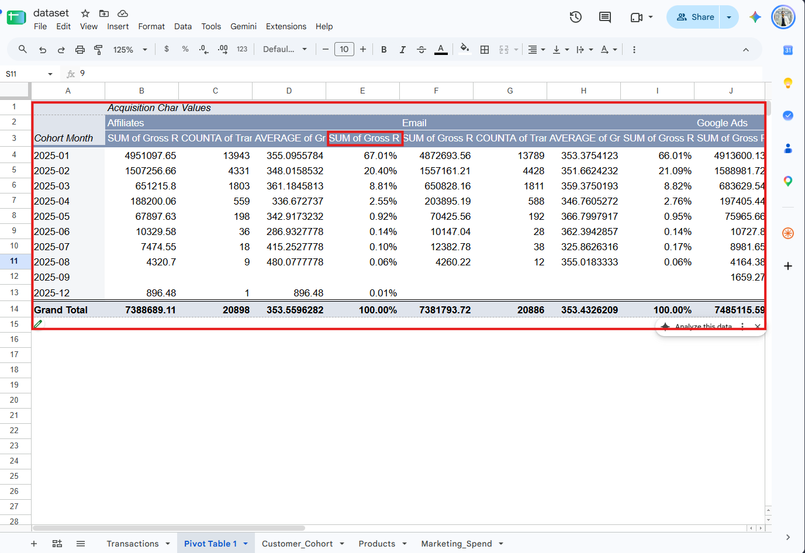

*Figure 15. Displaying each cohort's share of its acquisition channel's total gross revenue.*

**Why.** Absolute revenue highlights scale. Percentage contribution highlights the composition of a channel's revenue across cohorts. This makes the cohort mix easier to compare across channels with different total revenue.

> **Percentage interpretation:** These percentages represent each cohort's share **within a channel's column total**. They are not each channel's share of total business revenue.

### 5.7 Add interactive slicers

**Action.** Added two slicers to the Pivot Table:

- `Acquisition Channel`
- `Cohort Month`

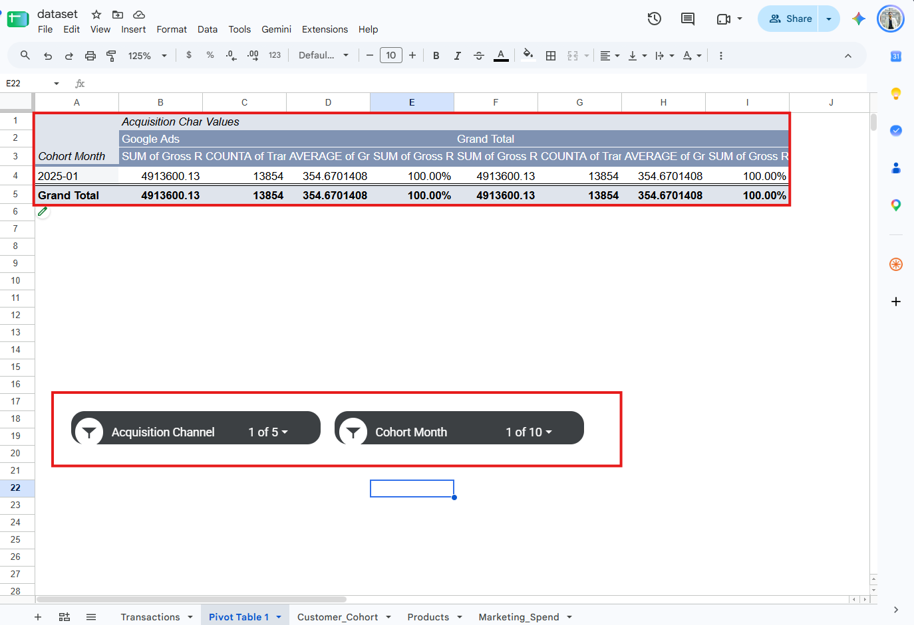

*Figure 16. Interactive slicers for acquisition channel and cohort month.*

**Why.** Slicers allow the reviewer to filter the summary without editing the Pivot Table structure. The screenshot shows one of five channels and one of ten cohort months selected, with the displayed view filtered to Google Ads and cohort month `2025-01`.

## 6. Findings and interpretation

The following observations are supported by the visible workbook outputs.

### 6.1 Acquisition cost comparison

Organic Search has the lowest displayed CAC (**$6.25**), while Google Ads has the highest (**$20.83**) among the five listed channels. Meta Ads is close at **$20.00**.

This suggests that Organic Search is the least expensive acquisition channel according to the supplied spend and new-customer figures. However, lower CAC does not automatically mean higher profitability or better customer quality.

### 6.2 Cohort revenue distribution

The displayed Pivot Table reports approximately **$37.21 million** in total gross revenue across the included channels and cohorts. The `2025-01` cohort has the largest visible revenue amount in the table, with later cohorts showing lower totals.

This pattern should be interpreted cautiously. Earlier cohorts have had more time to generate transactions, and the dataset may contain unequal observation windows across cohorts.

### 6.3 Why the additional Pivot Table metrics matter

| Metric | What it measures | Analytical use |
|---|---|---|
| Gross Revenue (SUM) | Total transaction sales value | Revenue scale |
| Transaction ID (COUNTA) | Number of transaction records | Transaction volume |
| Gross Revenue (AVERAGE) | Mean revenue per transaction | Average transaction value |
| Gross Revenue (% of column) | Cohort share of channel revenue | Cohort mix |

Using these metrics together reduces the risk of interpreting high revenue without understanding whether it came from many transactions or larger average transactions.

## 7. Data-quality considerations and limitations

1. **Gross revenue is not profit.** Product cost, marketing spend, discounts, returns, taxes, and fulfilment costs are not deducted from the transaction revenue calculation.
2. **CAC is channel-level.** CAC is calculated from channel totals and repeated onto transaction rows. It should not be summed across transactions.
3. **Consistent measurement periods are required.** Marketing spend and new-customer counts must refer to compatible periods and channel definitions.
4. **First purchase is based on available history.** If earlier transactions are missing from the source data, the calculated first purchase date may not be the customer's true first-ever purchase.
5. **Cohort maturity differs.** Recent cohorts have had less time to accumulate repeat purchases and revenue. Comparing raw cohort totals without accounting for cohort age can be misleading.
6. **Descriptive analysis is not causal inference.** The Pivot Table describes observed revenue patterns; it does not prove that a channel caused the revenue.
7. **Attribution assumptions matter.** The acquisition channel assigned to a customer should be defined consistently and validated before making budget decisions.
8. **Percentage-of-column values need careful reading.** They show within-channel cohort composition, not channel market share or share of company-wide revenue.

## 8. Conclusion and next steps

The assignment successfully transformed raw transaction records into a structured marketing analysis in Google Sheets. Product prices were retrieved using `XLOOKUP`, gross revenue was calculated, customer first-purchase dates were derived using `QUERY`, and monthly cohorts were created and mapped back to transaction records. Channel CAC was calculated from marketing-spend data and attached to transactions. Finally, a Pivot Table summarized revenue, transaction count, and average transaction revenue by cohort and channel, while slicers enabled interactive filtering.

### Recommended next improvements

| Priority | Improvement | Why it matters |
|---|---|---|
| High | Calculate gross margin after product cost | Separates sales value from economic contribution |
| High | Calculate customer-level repeat purchase rate | Evaluates retention by acquisition cohort |
| High | Calculate customer lifetime value (LTV) | Enables LTV-to-CAC comparison |
| Medium | Normalize cohort results by cohort age | Makes newer and older cohorts more comparable |
| Medium | Validate channel attribution and spend windows | Improves reliability of channel comparisons |
| Medium | Add monthly trend charts and KPI cards | Improves dashboard readability |

A stronger future version could compare **LTV:CAC**, payback period, repeat-purchase rate, and cohort retention. These metrics would support more defensible channel investment decisions than CAC and gross revenue alone.

---

## Appendix A — Formula reference

| Field | Formula / operation | Purpose |
|---|---|---|
| Unit Price | `=XLOOKUP(D2, Products!$A$2:$A$51, Products!$C$2:$C$51, 0)` | Return unit price using Product ID |
| Gross Revenue | `=E2*G2` | Multiply units sold by unit price |
| First Purchase Date | `QUERY` + `MIN(Date)`, grouped by Customer ID | Return earliest observed transaction date per customer |
| Cohort Month | `=TEXT(B2, "yyyy-mm")` | Convert first-purchase date to year-month |
| Transaction Cohort Month | `=XLOOKUP(B2, Customer_Cohort!$A$2:$A, Customer_Cohort!$C$2:$C, "")` | Map each customer to their cohort |
| Channel CAC | `=B2/C2` | Divide channel spend by new customers |
| Transaction Channel CAC | `=XLOOKUP(F2, Marketing_Spend!$A$2:$A$6, Marketing_Spend!$D$2:$D$6, 0)` | Map channel CAC onto transactions |

### Formula design notes

- Use absolute references for lookup ranges when filling formulas down, so the lookup range does not shift.
- Use exact-match lookup behavior for identifiers such as Product ID and Customer ID.
- Confirm that date columns are stored as dates, not text, before applying `MIN` or date formatting.
- Check that each lookup key is unique in its reference table. Duplicate product or customer keys can produce ambiguous results.
- In production analysis, consider explicit error handling (for example, `IFNA`) so missing reference records can be audited rather than silently interpreted as zero.

## Appendix B — Evidence index

All evidence images are stored in the sibling `Assets/` directory. The report uses relative image paths so it can be moved together with that directory.

| Figure | Evidence |
|---:|---|
| 1 | File → Import |
| 2 | Upload Transactions CSV |
| 3 | Insert new sheet(s) and import |
| 4 | Verify imported transaction columns |
| 5 | XLOOKUP product unit price |
| 6 | Calculate gross revenue |
| 7 | QUERY customer first purchase date |
| 8 | Derive cohort month |
| 9 | XLOOKUP cohort month into transactions |
| 10 | Calculate channel CAC |
| 11 | XLOOKUP channel CAC into transactions |
| 12 | Create Pivot Table |
| 13 | Configure cohort rows, channel columns, and revenue sum |
| 14 | Add transaction count and average revenue |
| 15 | Show revenue as percentage of channel total |
| 16 | Add channel and cohort slicers |

---

<div align="center">

**END OF REPORT**

*DS 4115 · Marketing Analytics · E-commerce Revenue & Customer Cohort Analysis*

</div>
