# Customer Segmentation Using RFM Analysis, K-Means Clustering, and Tableau
## Detailed Technical Laboratory Report

**Course:** Marketing Analytics  
**Course Code:** DS 4115  
**Lab:** Lab 3 — Customer Segmentation using RFM Analysis, K-Means Clustering, and Tableau Visualization  
**Student Name:** Musfique Ahmed  
**Student ID:** 0152330101  
**Notebook:** `Lab3_Assignment_0152330101.ipynb`  
**Tableau Workbook:** `Lab3_RFM_Tableau_Dashboard`  
**Submission Date:** 23 November 2026

---

# Abstract

This laboratory exercise develops an end-to-end customer segmentation workflow by integrating transaction-data generation, feature engineering, unsupervised machine learning, customer persona interpretation, and business intelligence visualization. A synthetic transaction dataset containing 15,000 transaction records across 1,000 unique customers was generated in Python. The transaction-level data were transformed into a customer-level RFM analytical table using Recency, Frequency, and Monetary metrics. These three measures were standardized with Scikit-learn's `StandardScaler` before applying K-Means clustering with four clusters. Cluster-level statistics were then examined to interpret the purchasing behavior of each group and assign four business-facing personas: Loyal Customers, Recent / New Visitors, At-Risk / Lost, and Champions. The enriched customer dataset was exported as a CSV file and imported into Tableau Public. Two worksheets—a customer segment volume bar chart and an RFM behavioral scatter plot—were combined into a dashboard. The report documents not only the outputs but also the purpose, implementation logic, and methodological reasoning behind each major decision. Since the source transactions are synthetic, the results are a demonstration of the analytical workflow rather than empirical findings about a real business.

# 1. Introduction

## 1.1 Background

Customer segmentation is the process of dividing a customer base into groups that share similar characteristics or behavioral patterns. In marketing analytics, segmentation allows an organization to move beyond a single, generic marketing strategy and design different approaches for customer acquisition, retention, engagement, and reactivation.

Transaction data contain useful behavioral information, but raw transaction logs are not immediately suitable for customer-level segmentation. A transaction table typically contains multiple rows for the same customer. A customer may purchase once or many times, and each transaction has its own date and monetary value. To compare customers fairly, the transaction history must first be summarized into meaningful customer-level features.

This lab uses RFM analysis for that purpose. RFM is a widely used behavioral framework based on three dimensions:

- **Recency (R):** How recently did the customer make a purchase?
- **Frequency (F):** How often did the customer make a purchase?
- **Monetary (M):** How much did the customer spend over the observation period?

The RFM representation is then used as input to K-Means, an unsupervised clustering algorithm. The final customer segments are interpreted and visualized in Tableau Public.

## 1.2 Why an RFM-based approach?

RFM was selected because it converts raw transaction histories into a compact representation of customer purchasing behavior. Each metric captures a different aspect of the relationship between a customer and a business:

- Recency reflects the freshness of customer activity and can help identify customers who may be becoming inactive.
- Frequency reflects repeat-purchase behavior and helps distinguish occasional buyers from frequent buyers.
- Monetary reflects cumulative spending and helps identify customers who contribute relatively high transaction value.

Using all three dimensions is more informative than using transaction count or spending alone. For example, two customers may have spent the same total amount, but one may have made many small purchases recently while the other made a single large purchase a long time ago. RFM can distinguish these patterns.

## 1.3 Why combine RFM with K-Means?

RFM feature engineering creates a numerical profile for each customer, but it does not automatically determine how many behavioral groups exist or which customers have similar combinations of RFM values. K-Means is used to group customers based on similarity across all three standardized dimensions.

The combination provides two complementary stages:

1. **RFM feature engineering:** Converts transaction histories into meaningful customer-level behavioral variables.
2. **K-Means clustering:** Identifies groups of customers with similar RFM profiles without requiring predefined class labels.

The numerical cluster identifiers are subsequently interpreted using cluster statistics and translated into business-facing customer personas.

## 1.4 Objectives

The objectives of the lab, following the course manual, are to:

1. Generate or acquire transaction-level customer data.
2. Compute customer-level Recency, Frequency, and Monetary metrics using Pandas.
3. Standardize the RFM features using `StandardScaler`.
4. Train a K-Means clustering model to identify behavioral customer groups.
5. Examine cluster profiles and interpret the resulting customer segments.
6. Map numeric cluster identifiers to human-readable customer personas.
7. Export the enriched customer dataset to CSV.
8. Import the CSV into Tableau Public.
9. Build a customer segment distribution chart and an RFM behavioral scatter plot.
10. Combine the worksheets into an interactive customer persona dashboard.

# 2. Overall Workflow and Analytical Design

The assignment follows a sequential data analytics pipeline. Each stage produces an output required by the next stage.

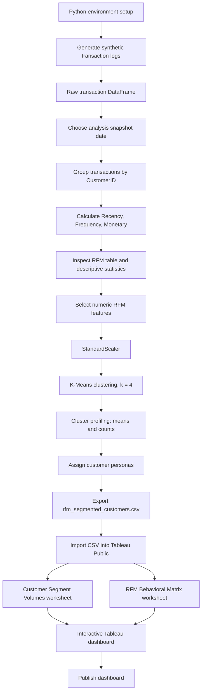

**Figure 1.** End-to-end workflow from synthetic transaction generation to Tableau dashboard publication.

The workflow deliberately separates data preparation, feature engineering, modeling, interpretation, and communication. This separation makes the analysis easier to inspect and debug. It also ensures that the Tableau dashboard uses the enriched customer-level dataset rather than the original transaction-level logs.

# 3. Part 0 — Environment Setup and Dataset Acquisition

## 3.1 Development environment

The implementation was completed in Google Colab using Python. Google Colab provides a hosted notebook environment in which code, explanatory text, outputs, and visualizations can be organized in one document.

The notebook imports the following libraries:

```python
import pandas as pd
import numpy as np
import datetime as dt

from sklearn.preprocessing import StandardScaler
from sklearn.cluster import KMeans

import matplotlib.pyplot as plt
import seaborn as sns

sns.set_theme(style="whitegrid")
```

### Why these libraries were used

| Library | Role in the assignment | Reason for selection |
|---|---|---|
| Pandas | DataFrame creation, grouping, aggregation, inspection, and CSV export | Provides efficient tabular data manipulation and customer-level aggregation |
| NumPy | Random data generation and numerical operations | Supports reproducible generation of transaction attributes |
| `datetime` | Date creation and date arithmetic | Required to generate transaction dates and calculate elapsed days for Recency |
| Scikit-learn `StandardScaler` | Feature standardization | Places RFM features on comparable scales before distance-based clustering |
| Scikit-learn `KMeans` | Unsupervised clustering | Groups customers based on similarity in their RFM feature vectors |
| Matplotlib | Plot rendering | Provides the underlying plotting interface |
| Seaborn | Statistical visualization | Simplifies creation of readable statistical plots and applies a consistent visual theme |

The libraries were imported at the beginning so that data generation, transformation, modeling, and visualization could be performed in a consistent environment.

**Screenshot evidence**

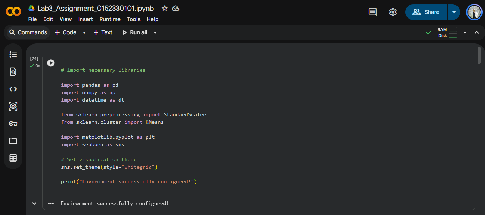

*Figure 2. Importing the required libraries and configuring the visualization theme in Google Colab.*

## 3.2 Why synthetic data were generated

The lab manual instructs students to generate synthetic customer transaction logs. Synthetic data provide a controlled dataset for demonstrating the full analytical process without requiring access to private customer records or an external commercial database.

The generated dataset contains:

| Property | Configuration |
|---|---:|
| Transaction records | 15,000 |
| Intended customer ID range | 1,000–1,999 |
| Unique customers observed | 1,000 |
| Observation period | 365 days |
| Start date | 1 January 2025 |
| Random seed | 42 |
| Transaction value distribution | Exponential distribution with scale 75, plus 10 |

Synthetic data are appropriate for learning and demonstrating data engineering and clustering steps. However, because the records are randomly generated, the resulting patterns cannot be treated as evidence of actual consumer behavior.

## 3.3 Reproducibility through a random seed

```python
np.random.seed(42)
```

A random seed initializes the pseudo-random number generator. Without a fixed seed, executing the notebook again may generate different customer assignments, transaction dates, and order values. This would change the RFM features and potentially the clustering output.

Using `42` makes the random generation reproducible in the same execution environment and helps compare results across notebook runs. The particular number 42 has no special statistical meaning; it is simply a fixed seed.

## 3.4 Generating transaction records

```python
n_transactions = 15000
start_date = dt.datetime(2025, 1, 1)

customer_ids = [
    f"CUST_{np.random.randint(1000, 2000)}"
    for _ in range(n_transactions)
]

transaction_ids = [
    f"TXN_{str(i).zfill(6)}"
    for i in range(1, n_transactions + 1)
]

random_days = np.random.randint(0, 365, size=n_transactions)

transaction_dates = [
    start_date + dt.timedelta(days=int(d))
    for d in random_days
]

order_values = np.round(
    np.random.exponential(scale=75, size=n_transactions) + 10,
    2
)
```

### Explanation of the implementation decisions

**A. Number of transactions**

`n_transactions = 15000` defines the number of transaction rows to generate. The assignment needs multiple transactions per customer so that Recency, Frequency, and Monetary can be calculated from transaction histories.

**B. Customer identifiers**

`np.random.randint(1000, 2000)` generates an integer in the range 1000 to 1999. The `CUST_` prefix makes the values readable customer identifiers.

Customer IDs are sampled repeatedly, so the same customer can appear in multiple transaction rows. This repeated appearance is essential: RFM analysis requires a transaction history for each customer, not merely one row per customer.

**C. Transaction identifiers**

Each transaction receives a sequential ID. `zfill(6)` pads the numeric portion with leading zeros, producing identifiers such as `TXN_000001`. A unique transaction identifier makes each transaction distinguishable and allows the transaction count to be computed.

**D. Transaction dates**

A random integer from 0 to 364 is generated for each transaction. That number of days is added to 1 January 2025. This creates dates across a 365-day observation period.

**E. Order values**

The order values are generated from an exponential distribution and shifted upward by 10:

\[
\text{OrderValue}_i =
\operatorname{round}(\operatorname{Exponential}(75)+10,2)
\]

The exponential distribution is positively skewed: it can produce many relatively small values and a smaller number of larger values. This is a useful synthetic pattern for demonstrating transaction-value aggregation. The scale parameter of 75 controls the distribution's scale; adding 10 ensures generated values are shifted above zero. These are simulation parameters, not estimates from a real business.

## 3.5 Creating and saving the raw transaction DataFrame

```python
raw_df = pd.DataFrame({
    'TransactionID': transaction_ids,
    'CustomerID': customer_ids,
    'TransactionDate': transaction_dates,
    'OrderValue': order_values
})

raw_df.to_csv('raw_customer_transactions.csv', index=False)

print(
    f"Dataset successfully created with {len(raw_df)} transaction logs "
    f"across {raw_df['CustomerID'].nunique()} unique customers!"
)

raw_df.head()
```

Pandas `DataFrame` organizes the generated lists into a structured table. Saving the raw table to CSV preserves the transaction-level data as an intermediate artifact. The `index=False` argument prevents Pandas from writing its default row index as an unnecessary extra column.

The `head()` method displays the first five records for a quick structural check. The `len()` function reports the number of rows, while `nunique()` verifies the number of distinct customers.

**Observed output:** 15,000 transaction logs across 1,000 unique customers.

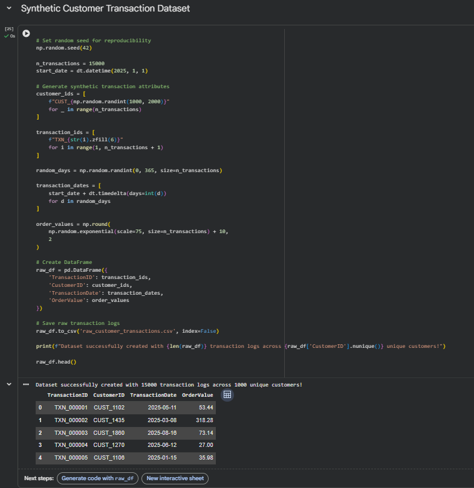

*Figure 3. Synthetic transaction generation and inspection of the raw transaction DataFrame.*

# 4. Part 1 — Feature Engineering: Computing the RFM Metrics

## 4.1 Why feature engineering is necessary

The raw transaction table is transaction-centric: each row represents one purchase. Customer segmentation, however, requires one comparable feature vector per customer.

For example, a customer with 20 transactions appears in 20 raw rows, while a customer with only 2 transactions appears in 2 rows. Applying clustering directly to the raw transaction table would cluster individual transactions rather than customer histories. That would not answer the assignment's central question: which customers exhibit similar purchasing behavior?

Feature engineering transforms multiple transaction records into a single customer-level summary. In this lab, the summary is the RFM table.

## 4.2 What is the calculated RFM matrix?

The term **RFM matrix** in this assignment refers to the customer-level analytical table in which each row represents one customer and the columns represent Recency, Frequency, and Monetary values.

Conceptually, the matrix has the following structure:

| CustomerID | Recency | Frequency | Monetary |
|---|---:|---:|---:|
| CUST_1000 | 15 | 19 | 1,586.42 |
| CUST_1001 | 39 | 15 | 1,061.24 |
| CUST_1002 | 10 | 12 | 1,240.64 |
| CUST_1003 | 40 | 10 | 1,003.76 |
| CUST_1004 | 30 | 10 | 1,058.63 |

*Illustrative rows shown from the executed notebook output.*

The RFM table is necessary because:

1. It converts transaction-level data into a consistent customer-level representation.
2. It preserves three complementary dimensions of purchase behavior.
3. It provides numerical input features for the clustering algorithm.
4. It makes customer-level profiling and business interpretation possible.
5. It provides a single enriched table that can later be exported to Tableau.

This is not a conventional pivot table with three RFM score categories. The notebook calculates raw numeric RFM metrics and then uses those numeric values as clustering features. No 1–5 RFM scoring or RFM quintile calculation is shown in the executed notebook.

## 4.3 Defining the snapshot date

```python
snapshot_date = raw_df['TransactionDate'].max() + dt.timedelta(days=1)
```

Recency is a time-difference metric. It cannot be calculated without a reference date. The snapshot date represents the date at which customer activity is evaluated.

The notebook uses the latest transaction date in the dataset and adds one day. The observed snapshot date is **1 January 2026**.

### Why add one day?

Using the day after the final transaction creates a reference point immediately after the observation window. It also ensures that the most recent transaction has a Recency value of at least one day rather than zero days.

The use of a data-derived snapshot date is preferable to using the computer's current date because the analysis is based on a fixed historical observation period. If the notebook were rerun at a later calendar date, using today's date would artificially increase every customer's Recency even though the underlying transaction dataset had not changed.

## 4.4 Calculating Recency

\[
R_i = \left(\text{Snapshot Date} -
\text{Latest Transaction Date}_i\right).days
\]

Recency is the number of days since customer \(i\)'s most recent transaction.

The code uses:

```python
'TransactionDate': lambda x: (snapshot_date - x.max()).days
```

Here, `x` contains the transaction dates for one customer. `x.max()` selects that customer's latest transaction date. Subtracting it from the snapshot date gives the elapsed time in days.

**Why use the maximum transaction date?**

The most recent purchase is the relevant event for measuring how recently a customer interacted with the business. Using the minimum date would measure the customer's first observed purchase, which is a different concept.

**How to interpret Recency:**

- Lower Recency: the customer purchased more recently.
- Higher Recency: more time has passed since the customer's latest purchase.

Therefore, unlike Frequency and Monetary, lower Recency generally indicates more recent activity.

## 4.5 Calculating Frequency

\[
F_i = \text{Number of transactions made by customer }i
\]

The code uses:

```python
'TransactionID': 'count'
```

The transaction ID is counted for each customer. Because the notebook generates a unique transaction ID for every transaction, counting transaction IDs gives the number of transactions associated with that customer.

**Why use transaction count?**

Frequency captures repeat-purchase behavior. A customer who makes many purchases demonstrates a different relationship with the business from a customer who makes only one or two purchases, even if their total spending is similar.

A higher Frequency indicates more transactions during the observation period.

## 4.6 Calculating Monetary

\[
M_i = \sum_{j=1}^{n_i}\text{OrderValue}_{ij}
\]

The code uses:

```python
'OrderValue': 'sum'
```

For each customer, Pandas adds the order values of all associated transactions.

**Why use the sum?**

The objective is to measure total customer spending over the observation period. The sum captures cumulative transaction value. An average order value would answer a different question: how much the customer spends per transaction on average.

In this assignment, Monetary is therefore a cumulative value, not profit, margin, or customer lifetime value.

## 4.7 Grouping and aggregating the transaction table

```python
rfm_df = raw_df.groupby('CustomerID').agg({
    'TransactionDate': lambda x: (snapshot_date - x.max()).days,
    'TransactionID': 'count',
    'OrderValue': 'sum'
}).reset_index()

rfm_df.columns = [
    'CustomerID',
    'Recency',
    'Frequency',
    'Monetary'
]
```

### Why use `groupby('CustomerID')`?

`groupby()` partitions the transaction table into customer-specific groups. The aggregation functions are then applied independently to each group. This guarantees that each output row summarizes one customer rather than mixing transactions from different customers.

### Why use `.agg()`?

Different RFM variables require different aggregation logic:

- Transaction dates require a maximum date followed by date subtraction.
- Transaction IDs require counting.
- Order values require summation.

`.agg()` allows these operations to be defined together in one grouped transformation.

### Why use `.reset_index()`?

After grouping, Pandas uses `CustomerID` as the group index. `reset_index()` converts it back into a regular column, making it easier to inspect, export, and use in subsequent operations.

### Why rename the columns?

The aggregation initially retains the original source column names. Renaming them to `CustomerID`, `Recency`, `Frequency`, and `Monetary` gives the analytical table clear, standardized field names that correspond to the RFM framework.

## 4.8 Inspecting the RFM matrix

The notebook checks the first five records, dataset shape, missing values, and descriptive statistics.

```python
rfm_df.head()

print("Dataset Shape:", rfm_df.shape)
print("Missing Values:")
print(rfm_df.isnull().sum())

display(
    rfm_df[['Recency', 'Frequency', 'Monetary']].describe()
)
```

### Why perform these checks?

- `head()` verifies that the aggregation produced readable customer-level records.
- `shape` verifies the number of rows and columns.
- `isnull().sum()` checks whether any customer-level metric is missing.
- `describe()` provides distribution summaries, including count, mean, standard deviation, quartiles, minimum, and maximum.

These checks are important before modeling. A clustering algorithm expects numerical input and can be affected by missing or malformed values. Descriptive statistics also help identify differences in feature ranges that may require preprocessing.

### Observed data quality and descriptive statistics

The RFM dataset contains **1,000 rows and 4 columns**, with no missing values in the reported fields.

| Statistic | Recency | Frequency | Monetary |
|---|---:|---:|---:|
| Count | 1,000 | 1,000 | 1,000 |
| Mean | 24.622 | 15.000 | 1,281.24098 |
| Standard deviation | 23.788109 | 3.985459 | 435.97341 |
| Minimum | 1 | 5 | 175.95000 |
| 25th percentile | 7.75 | 12 | 988.19250 |
| Median | 17 | 15 | 1,250.21500 |
| 75th percentile | 34 | 18 | 1,533.10000 |
| Maximum | 144 | 29 | 2,760.52000 |

The feature ranges differ substantially. Monetary values are in the hundreds or thousands, whereas Frequency is a count with a range from 5 to 29. This matters because the next stage uses a distance-based algorithm.

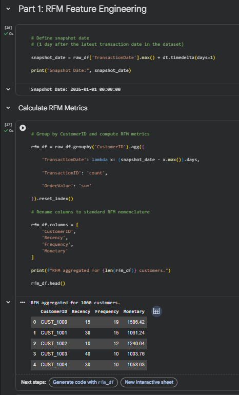

*Figure 4. Snapshot date definition and customer-level RFM aggregation.*

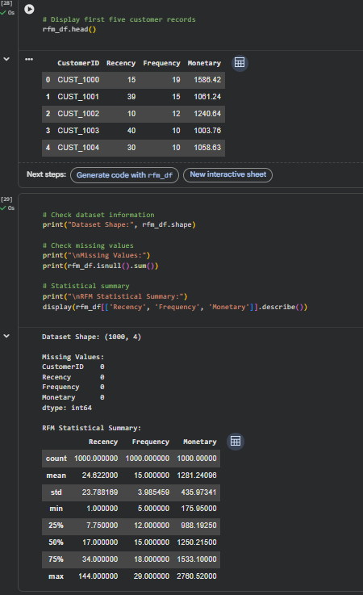

*Figure 5. RFM matrix validation, missing-value inspection, and descriptive statistics.*

# 5. Part 2 — Feature Scaling and K-Means Clustering

## 5.1 Why feature scaling is required

K-Means uses distances between observations to assign customers to clusters. In this assignment, each customer is represented by three features:

\[
\mathbf{x}_i = [R_i, F_i, M_i]
\]

The features are measured on different numerical scales. Monetary has values that can reach thousands, while Frequency is a relatively small integer count. If raw values were passed directly into a distance-based algorithm, a numerical difference of several hundred in Monetary could dominate smaller numerical differences in Frequency.

This would make the resulting clusters disproportionately influenced by the feature with the largest scale, rather than treating the three behavioral dimensions comparably.

For this reason, the lab manual instructs students to standardize the RFM features before K-Means.

## 5.2 Selecting the model features

```python
rfm_features = rfm_df[['Recency', 'Frequency', 'Monetary']]
```

Only the three numeric RFM metrics are selected as clustering inputs.

**Why exclude `CustomerID`?**

CustomerID is an identifier, not a behavioral measurement. Its numeric-looking or string representation does not indicate customer activity. Including an identifier in distance calculations would introduce meaningless numerical relationships.

**Why exclude `Cluster` and `Customer_Persona`?**

These fields do not exist before clustering. They are outputs created after the model is fitted. Using them as input features would introduce target leakage or circular logic.

## 5.3 Standardizing with `StandardScaler`

```python
scaler = StandardScaler()
rfm_scaled = scaler.fit_transform(rfm_features)
```

`StandardScaler` applies z-score standardization to each feature:

\[
z = \frac{x-\mu}{\sigma}
\]

where:

- \(x\) is an original feature value.
- \(\mu\) is the mean of that feature in the training data.
- \(\sigma\) is the standard deviation of that feature.
- \(z\) is the standardized value.

After transformation, each feature has approximately zero mean and unit variance.

### Why use `StandardScaler` instead of leaving the values unchanged?

Standardization reduces the influence of differences in measurement units and numerical range. It makes Recency, Frequency, and Monetary more comparable for Euclidean-distance-based clustering.

Standardization does not make the distributions normal, remove outliers, or guarantee that every feature has equal business importance. It only rescales each feature according to its mean and standard deviation.

## 5.4 Why convert the scaled array back into a DataFrame?

```python
rfm_scaled_df = pd.DataFrame(
    rfm_scaled,
    columns=[
        'Recency_Scaled',
        'Frequency_Scaled',
        'Monetary_Scaled'
    ]
)
```

Scikit-learn's `fit_transform()` returns a NumPy array. Converting it back into a Pandas DataFrame assigns readable column names and makes the transformed values easier to inspect.

This conversion is primarily for interpretability and verification. The K-Means model is fitted using `rfm_scaled`, the scaled numerical array.

## 5.5 Verifying the scaled features

```python
print(rfm_scaled_df.mean().round(4))
print(rfm_scaled_df.std().round(4))
```

The notebook checks the means and standard deviations after scaling.

The reported means are approximately 0.0. The displayed standard deviations are approximately 1.0005 because Pandas' `std()` uses the sample standard deviation by default, whereas `StandardScaler` uses the population variance convention when calculating the scaling factor.

This small difference is expected and does not indicate that standardization failed.

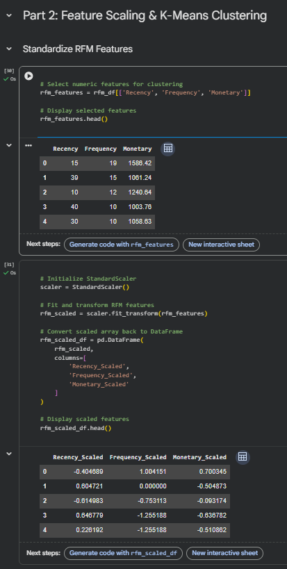

*Figure 6. Standardized Recency, Frequency, and Monetary features and verification of their scaled statistics.*

## 5.6 K-Means clustering

### How K-Means works

K-Means is an unsupervised clustering algorithm. It partitions observations into a predefined number of clusters. Each cluster is represented by a centroid, which is the mean feature vector of the observations assigned to that cluster.

The algorithm broadly follows these steps:

1. Initialize \(k\) cluster centroids.
2. Calculate the distance between each customer and the centroids.
3. Assign each customer to the nearest centroid.
4. Recalculate each centroid using the observations assigned to it.
5. Repeat the assignment and centroid-update steps until the solution converges or the iteration limit is reached.

The standard K-Means objective is to minimize within-cluster sum of squared distances:

\[
J = \sum_{j=1}^{k}\sum_{\mathbf{x}_i \in C_j}
\left\|\mathbf{x}_i-\boldsymbol{\mu}_j\right\|^2
\]

where \(C_j\) is cluster \(j\), and \(\boldsymbol{\mu}_j\) is its centroid.

### Why K-Means was used

K-Means is appropriate for this exercise because:

- The RFM features are numeric.
- The objective is to group customers by similarity without pre-existing customer labels.
- The algorithm produces a cluster identifier for every customer.
- The resulting centroids and cluster summaries can be interpreted in business terms.
- It is computationally practical for a dataset containing 1,000 customer records.

K-Means requires the number of clusters to be specified in advance. It also works best when the resulting groups are reasonably compact under the chosen distance metric. These assumptions should be considered when interpreting the output.

## 5.7 Selecting four clusters

```python
kmeans = KMeans(
    n_clusters=4,
    random_state=42,
    n_init=10
)
```

The lab manual explicitly specifies a K-Means model with \(K=4\). Therefore, four clusters were used to follow the assignment instructions and create four customer groups for persona interpretation.

**Important methodological distinction:** The executed notebook uses four clusters because the lab manual prescribes four. The available notebook evidence does not show an elbow-method comparison, silhouette-score analysis, or a systematic search over alternative values of \(K\). Therefore, the report does not claim that four was experimentally proven to be the globally optimal cluster count.

### Why `random_state=42`?

K-Means initialization can affect the final clustering result. Setting a fixed random state makes the initialization reproducible, so repeated runs under the same software and data conditions are more likely to return the same result.

### Why `n_init=10`?

K-Means can converge to different local solutions depending on its initial centroids. `n_init=10` instructs Scikit-learn to run the algorithm with ten different centroid initializations and retain the best solution according to its objective. This reduces dependence on a single potentially poor initialization.

## 5.8 Fitting the model and assigning cluster labels

```python
rfm_df['Cluster'] = kmeans.fit_predict(rfm_scaled)
```

`fit_predict()` performs two operations:

- `fit()` learns the cluster centroids from the standardized RFM observations.
- `predict()` assigns each customer to one of the learned clusters.

The returned numeric cluster label is stored in a new `Cluster` column in the original, unscaled RFM DataFrame.

**Why store the labels in the original RFM table?**

The original Recency, Frequency, and Monetary values are easier to interpret in their original units. Keeping the cluster label beside the original metrics allows the analysis to summarize and explain each cluster without converting standardized values back to business units.

The scaled values are used for model fitting; the original values are used for human-readable cluster profiling and Tableau reporting.

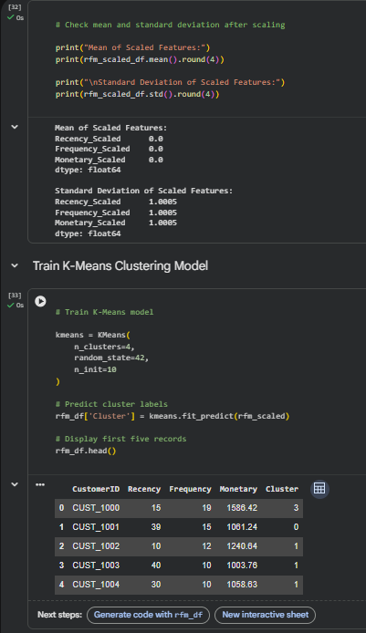

*Figure 7. Training the four-cluster K-Means model and appending the resulting cluster labels to the customer-level RFM table.*

## 5.9 Cluster profiling: why calculate cluster means and counts?

After the model assigns customers to clusters, the cluster numbers alone do not explain customer behavior. Cluster `0`, for example, is only an algorithm-generated identifier. It does not inherently mean Loyal Customers or At-Risk Customers.

The notebook therefore calculates a summary for each cluster:

```python
cluster_summary = rfm_df.groupby('Cluster').agg({
    'Recency': 'mean',
    'Frequency': 'mean',
    'Monetary': ['mean', 'count']
}).round(2)
```

### Why use the mean?

The mean provides a representative central value for each RFM feature within a cluster. Comparing cluster means helps reveal the behavioral differences between groups.

For example:

- A cluster with low mean Recency, high mean Frequency, and high mean Monetary may represent highly engaged, high-value customers.
- A cluster with high mean Recency may represent customers who have not purchased for a longer period.
- A cluster with lower Frequency and Monetary may represent customers with relatively limited observed purchasing activity.

### Why calculate the count?

The count indicates how many customers belong to each cluster. This is important because a segment's business relevance depends not only on its average behavior but also on its population size.

The cluster summary therefore supports both persona interpretation and the customer-volume chart created later in Tableau.

### Observed cluster summary

| Cluster | Mean Recency (days) | Mean Frequency | Mean Monetary | Customer Count |
|---:|---:|---:|---:|---:|
| 0 | 17.77 | 16.01 | 1,356.02 | 430 |
| 1 | 20.62 | 11.42 | 885.01 | 295 |
| 2 | 78.38 | 11.85 | 1,015.82 | 104 |
| 3 | 16.06 | 20.56 | 1,938.18 | 171 |
| **Total** | — | — | — | **1,000** |

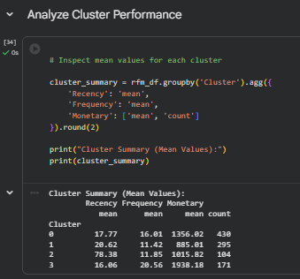

*Figure 8. Cluster-level mean Recency, Frequency, Monetary values, and customer counts.*

## 5.10 Visualizing the clusters in Python

```python
plt.figure(figsize=(10, 6))

sns.scatterplot(
    data=rfm_df,
    x='Recency',
    y='Monetary',
    hue='Cluster',
    palette='viridis',
    s=50
)

plt.title('Customer Segmentation using K-Means')
plt.xlabel('Recency')
plt.ylabel('Monetary')
plt.legend(title='Cluster')
plt.show()
```

### Why use a scatter plot?

A scatter plot allows the relationship between two numerical variables to be examined. Here, Recency is shown on the horizontal axis and Monetary on the vertical axis. Each point represents a customer, and color indicates the cluster assignment.

This plot helps visually inspect whether clusters occupy different regions of the Recency–Monetary space.

### Why use Recency and Monetary as the displayed axes?

Both variables have direct marketing interpretations: Recency indicates how recently a customer purchased, and Monetary indicates cumulative spending. Together they provide a useful visual comparison of customer activity and spending.

Frequency is still included in the K-Means model. It is simply not displayed on the two-dimensional chart. Therefore, the plot is a projection of a three-feature clustering result and cannot fully represent all dimensions used by the model.

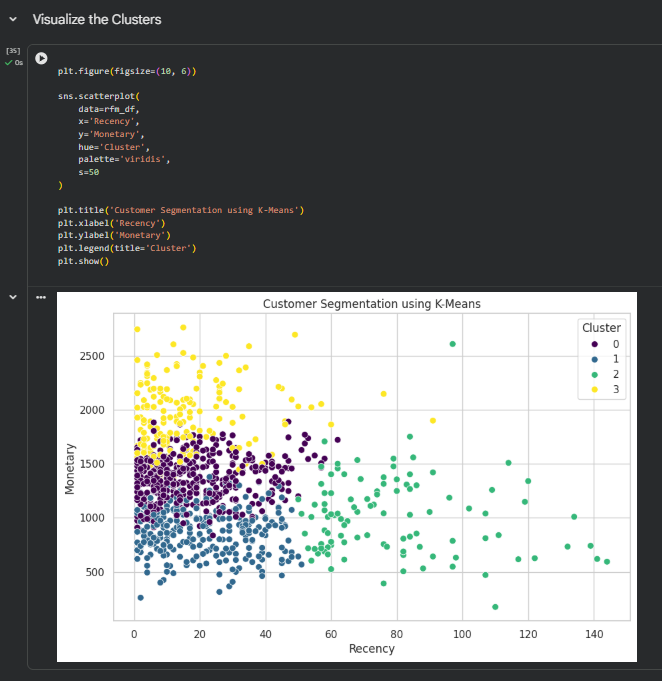

*Figure 9. Customer segmentation visualized using Recency and Monetary, with color indicating the cluster assignment.*

# 6. Customer Persona Assignment

## 6.1 Why map clusters to personas?

K-Means produces numeric labels, not marketing descriptions. A dashboard containing only labels such as Cluster 0, Cluster 1, Cluster 2, and Cluster 3 would be technically correct but less useful to a marketing audience.

Customer personas translate the cluster profiles into interpretable behavioral groups. This makes it easier to communicate what distinguishes each segment and to discuss possible marketing actions.

## 6.2 How the persona labels were assigned

The notebook maps the cluster identifiers using the following dictionary:

```python
persona_mapping = {
    0: 'Loyal Customers',
    1: 'Recent / New Visitors',
    2: 'At-Risk / Lost',
    3: 'Champions'
}

rfm_df['Customer_Persona'] = (
    rfm_df['Cluster'].map(persona_mapping)
)
```

The mapping is supported by the cluster summaries:

| Cluster | Evidence from RFM profile | Assigned persona | Reasoning |
|---:|---|---|---|
| 0 | Recency 17.77, Frequency 16.01, Monetary 1,356.02 | Loyal Customers | Relatively recent purchasing and repeat transaction activity, with substantial cumulative spending |
| 1 | Recency 20.62, Frequency 11.42, Monetary 885.01 | Recent / New Visitors | Lower frequency and the lowest monetary average among the four groups, indicating comparatively limited observed purchasing activity |
| 2 | Recency 78.38, Frequency 11.85, Monetary 1,015.82 | At-Risk / Lost | Much higher recency indicates a longer time since the latest purchase |
| 3 | Recency 16.06, Frequency 20.56, Monetary 1,938.18 | Champions | Highest frequency and monetary average, together with the lowest recency |

### Important note about cluster numbering

Cluster identifiers are arbitrary labels generated by the algorithm. The number assigned to a cluster does not carry an inherent behavioral meaning. If the initialization or data changes, the same behavioral group may receive a different numeric label.

The course manual provides an example mapping, but the executed notebook's cluster summary and persona dictionary are the basis for the mapping reported here. The labels were associated with the observed profiles, rather than treating the numeric cluster IDs as fixed business categories.

The term **Recent / New Visitors** should also be interpreted cautiously. The RFM table does not contain a first-time-customer flag. The group has comparatively low frequency and monetary values, but this alone does not prove that every customer is a first-time visitor.

## 6.3 Applying the mapping

The Pandas `map()` function replaces each numeric cluster identifier with its corresponding persona label. The resulting `Customer_Persona` column is added to the customer-level dataset.

This step preserves both the technical cluster assignment and its business-facing interpretation. Retaining both columns is useful for auditing and further analysis.

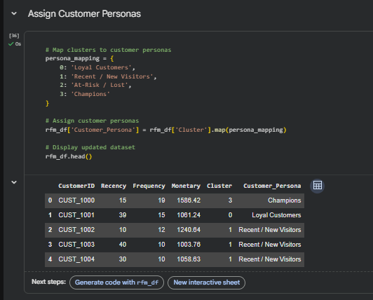

*Figure 10. Mapping the K-Means cluster labels to customer persona names.*

## 6.4 Verifying the persona distribution

```python
persona_counts = rfm_df['Customer_Persona'].value_counts()

print("Customer Persona Distribution:")
print(persona_counts)
```

`value_counts()` counts the number of records associated with each persona. Since the RFM table contains one row per customer, these counts represent the number of customers in each segment.

The notebook reports:

| Customer Persona | Customers | Percentage |
|---|---:|---:|
| Loyal Customers | 430 | 43.0% |
| Recent / New Visitors | 295 | 29.5% |
| At-Risk / Lost | 104 | 10.4% |
| Champions | 171 | 17.1% |
| **Total** | **1,000** | **100.0%** |

The counts sum to 1,000, matching the number of customer records in the RFM table. This is a useful consistency check: every customer should receive one cluster and one persona label.

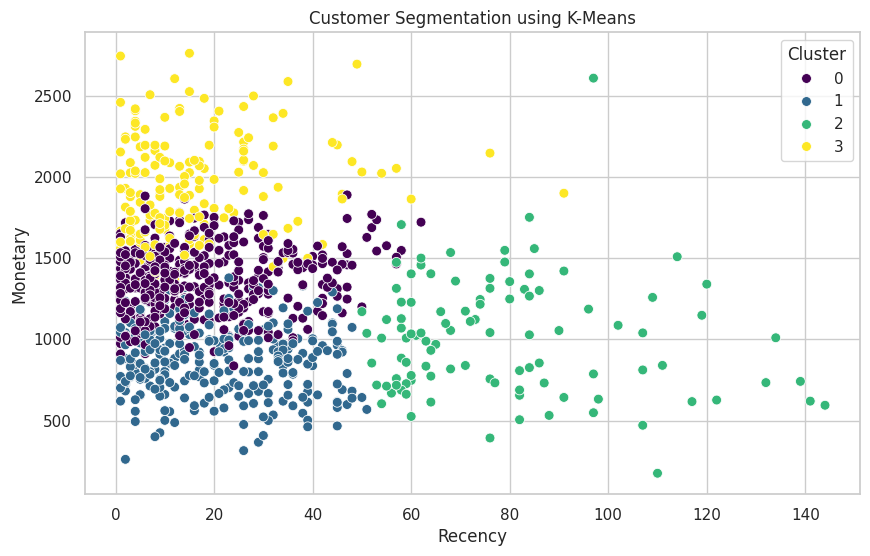

*Figure 11. Verification of the number of customers assigned to each persona.*

## 6.5 Exporting the segmented customer dataset

```python
rfm_df.to_csv(
    'rfm_segmented_customers.csv',
    index=False
)
```

The final customer-level dataset contains the original RFM features, the cluster identifier, and the persona label.

The CSV export is the handoff point between Python and Tableau. Tableau can connect directly to this file without having to rerun the feature engineering and clustering steps.

The `index=False` argument prevents an extra DataFrame index column from being included in the exported dataset.

# 7. Part 3 — Tableau Dashboard Construction

## 7.1 Why Tableau was used

Python was used for data generation, feature engineering, and clustering. Tableau was used to communicate the resulting segments through interactive visualizations.

The two tools serve different purposes:

- Python provides programmatic control over data transformation and machine learning.
- Tableau provides a visual interface for comparing segments, inspecting customer distributions, and presenting results to a business audience.

The lab manual specifically requires the enriched CSV to be imported into Tableau and used to build an interactive Customer Persona & RFM Dashboard.

## 7.2 Connecting the CSV data source

The file `rfm_segmented_customers.csv` was connected to Tableau Public using the Text File connection option.

The data source contains these fields:

| Field | Expected data type | Tableau role |
|---|---|---|
| CustomerID | String | Dimension / identifier |
| Recency | Numeric | Measure |
| Frequency | Numeric | Measure |
| Monetary | Numeric | Measure |
| Cluster | Numeric | Measure or discrete cluster identifier |
| Customer_Persona | String | Dimension |

### Why verify data types?

Tableau assigns different behavior to dimensions and measures. A customer identifier should be treated as a categorical identifier, not as a quantity to be summed or averaged. RFM metrics should be numeric so that they can be aggregated and plotted on axes. Persona should be categorical so that Tableau can group and color the marks by customer segment.

Verifying these roles prevents incorrect aggregations and supports the worksheet construction steps.

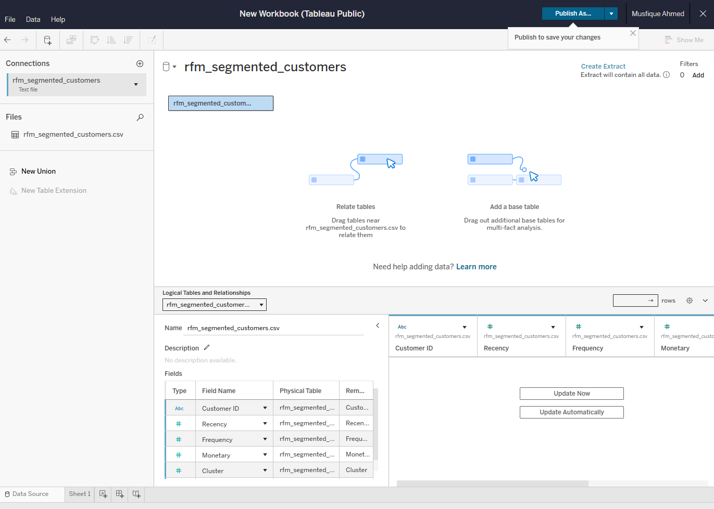

*Figure 12. Importing the segmented customer CSV into Tableau Public and inspecting the available fields.*

## 7.3 Worksheet 1 — Customer Segment Volumes

### Purpose of the worksheet

The first worksheet answers a basic but important business question:

**How many customers belong to each customer persona?**

A segment's average behavior does not show how large that segment is. The volume chart complements the cluster profile by showing the number of customers assigned to each persona.

### Construction steps

1. Create a new worksheet.
2. Drag `Customer_Persona` to Rows.
3. Drag `CustomerID` to Columns.
4. Change the aggregation of CustomerID to Count Distinct (`CNTD`).
5. Drag `Customer_Persona` to Color on the Marks card.
6. Enable mark labels so that the exact customer counts appear on the bars.
7. Rename the worksheet to `Customer Segment Volumes`.

### Why use Count Distinct instead of ordinary Count?

The intended metric is the number of unique customers in each persona. Count Distinct counts unique CustomerID values. This is more semantically accurate than counting rows if a dataset might contain repeated customer records.

In this particular export, the RFM table has one row per customer, so ordinary row count and distinct customer count should agree. Count Distinct makes the chart's intended measure explicit and robust to accidental duplicate rows.

### Why use a horizontal bar chart?

A bar chart is appropriate for comparing counts across categorical groups. Horizontal bars also provide room for longer persona labels and make relative segment sizes easy to compare.

### Why use persona as color?

Color visually separates the four customer groups and provides a consistent visual key that can be reused in the scatter plot and dashboard.

### Observed values

The Tableau chart displays:

- At-Risk / Lost: 104 customers
- Champions: 171 customers
- Loyal Customers: 430 customers
- Recent / New Visitors: 295 customers

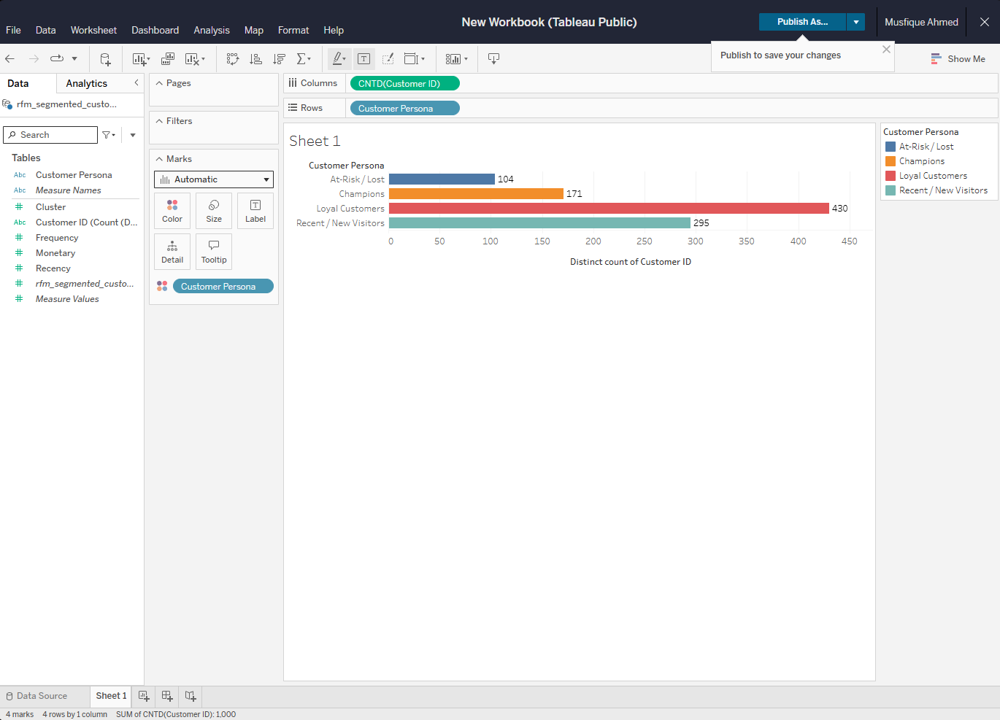

*Figure 13. Customer Segment Volumes worksheet showing the distinct customer count in each persona.*

## 7.4 Worksheet 2 — RFM Behavioral Matrix

### Purpose of the worksheet

The second worksheet answers a different question:

**How are customers distributed according to purchase recency and monetary value, and how do the personas differ?**

The bar chart shows segment sizes, but it cannot show the spread of individual customer values within each group. The scatter plot provides that behavioral view.

### Construction steps

1. Create a new worksheet.
2. Drag `Recency` to Columns.
3. Ensure the aggregation is `AVG(Recency)`.
4. Drag `Monetary` to Rows.
5. Ensure the aggregation is `AVG(Monetary)`.
6. Drag `CustomerID` to Detail on the Marks card.
7. Drag `Customer_Persona` to Color.
8. Rename the worksheet to `RFM Behavioral Matrix`.

### Why place Recency on Columns?

The horizontal axis represents how recently a customer purchased. Moving to the right indicates a larger Recency value and therefore a longer period since the customer's last transaction.

### Why place Monetary on Rows?

The vertical axis represents cumulative spending. Moving upward indicates a higher Monetary value.

Together, the axes help compare recent activity and spending. For example, customers toward the upper-left region have relatively low Recency and high Monetary values, a combination that can be associated with valuable, recently active customers.

### Why use CustomerID on Detail?

Without CustomerID on Detail, Tableau may aggregate the data into a small number of marks based on the fields already in the view. Adding CustomerID to Detail separates the view into customer-level marks, so each customer can be inspected as an individual point.

Because there is one row per customer in the exported RFM table, each mark represents an individual customer. The displayed AVG aggregations therefore resolve to that customer's own Recency and Monetary values.

### Why color by Customer_Persona?

Color makes it possible to compare the four model-derived groups in the same coordinate space. This connects the Tableau view directly to the persona interpretation performed in Python.

### Why is this called an RFM Behavioral Matrix?

The visualization is based on two of the three RFM dimensions—Recency and Monetary—while color represents the persona derived from all three RFM features. Frequency is still part of the K-Means model, even though it is not an axis in this particular scatter plot.

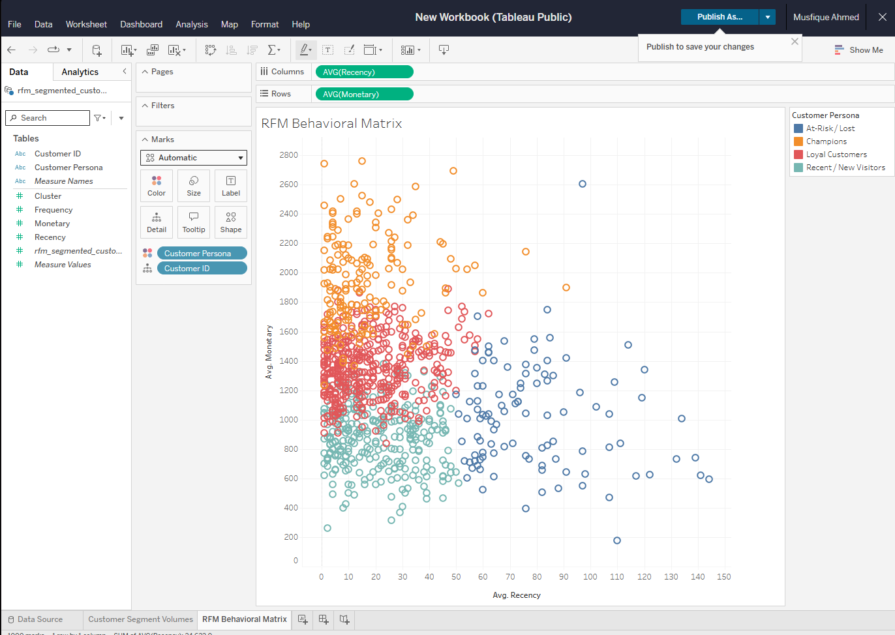

*Figure 14. Tableau worksheet setup for the Recency-versus-Monetary behavioral view.*

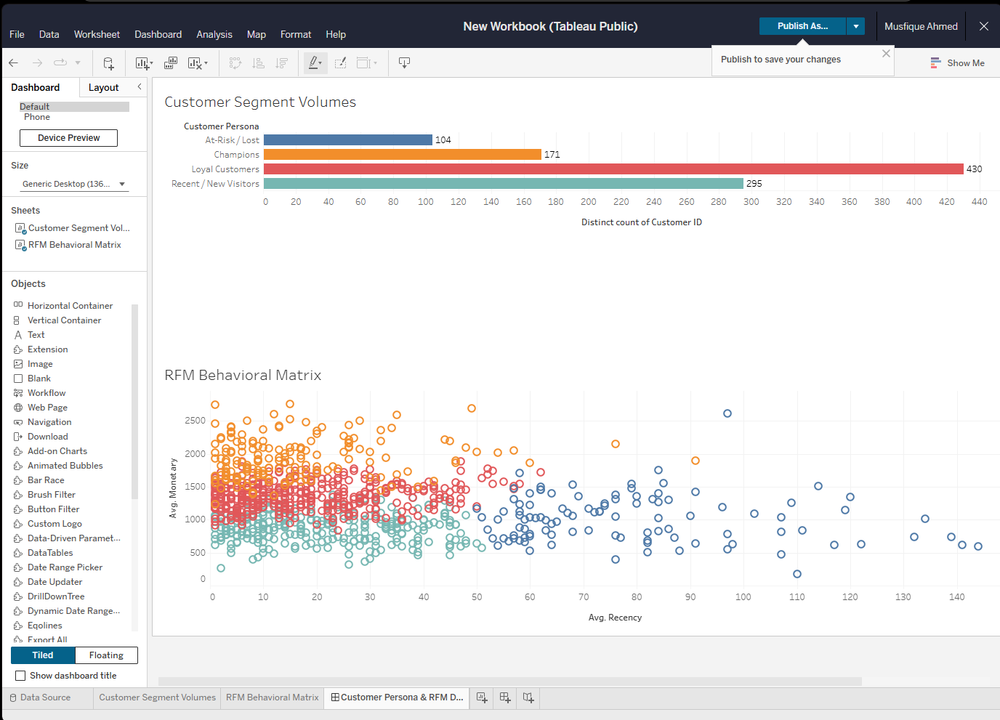

*Figure 15. Customer-level RFM scatter plot colored by customer persona.*

## 7.5 Constructing the combined dashboard

### Why create a dashboard instead of presenting worksheets separately?

Each worksheet communicates a different aspect of the analysis:

- Customer Segment Volumes communicates the size of each persona.
- RFM Behavioral Matrix communicates the distribution of customer behavior.

Combining them gives the viewer both a summary of segment population and a more detailed view of customer-level behavior in one place. This is more useful for executive or marketing interpretation than viewing the charts in isolation.

### Dashboard construction steps

1. Select New Dashboard.
2. Set the dashboard size to an appropriate desktop layout, such as Automatic or Desktop Browser (1366 × 768), as described in the lab manual.
3. Drag `Customer Segment Volumes` onto the upper part of the dashboard.
4. Drag `RFM Behavioral Matrix` onto the lower part of the dashboard.
5. Arrange the two worksheets so that both are visible and readable.
6. Enable the bar chart's **Use as Filter** interaction.
7. Test the dashboard by selecting a persona bar and observing the scatter plot.
8. Save the workbook as `Lab3_RFM_Tableau_Dashboard.twbx`.

### Why use the bar chart as a filter?

The **Use as Filter** action creates cross-filtering between the two worksheets. When a user clicks a persona bar, Tableau filters the scatter plot to show only the customers belonging to the selected persona.

For example, selecting Loyal Customers should filter the scatter plot to display only the 430 customers in that segment. This changes the dashboard from a static collection of charts into an interactive exploration tool.

### Why use a desktop dashboard layout?

The lab manual recommends Automatic or a desktop browser size. A desktop layout provides enough horizontal space for the customer-volume bars and enough vertical space for the scatter plot. The layout should preserve readable labels and prevent important chart areas from being compressed.

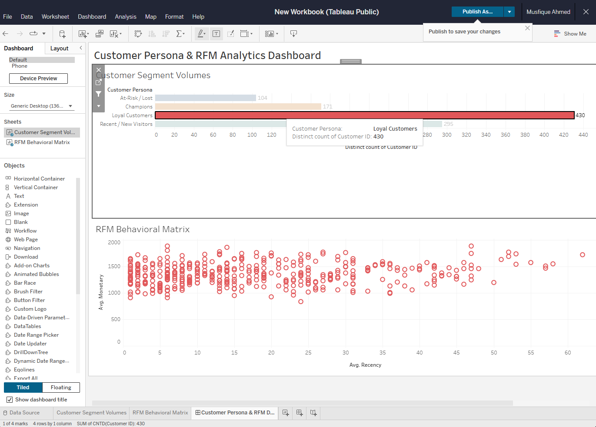

*Figure 16. Combined Customer Persona & RFM Analytics Dashboard with the two worksheets arranged vertically.*

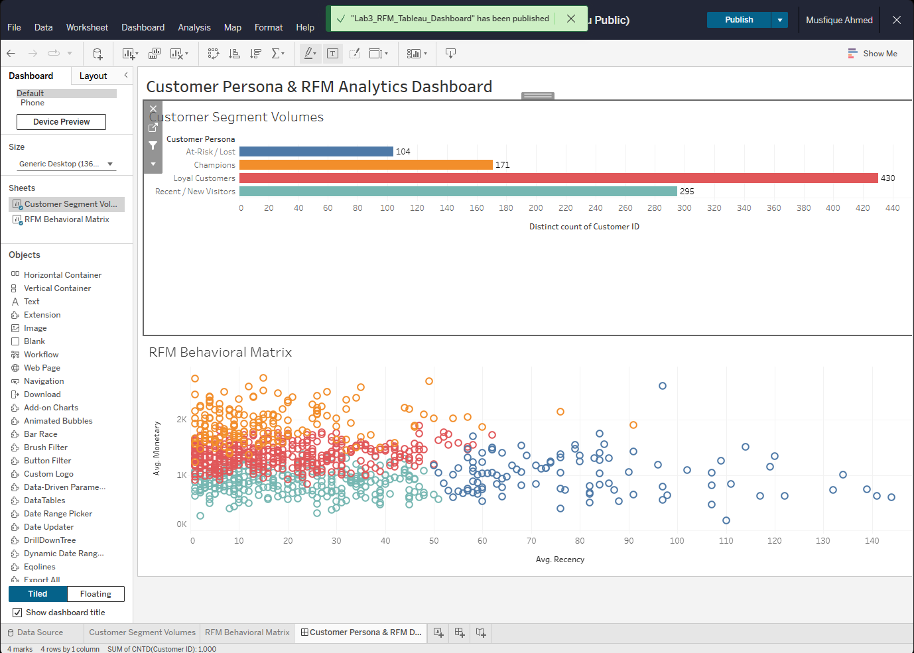

*Figure 17. Tableau dashboard interaction and published-workbook evidence. The dashboard should be tested by selecting a segment bar and confirming that the scatter plot filters accordingly.*

## 7.6 Publishing the Tableau workbook

The workbook was published to Tableau Public under the title `Lab3_RFM_Tableau_Dashboard`.

Publishing makes the dashboard accessible through a web link and allows the completed visualization to be shared without requiring the recipient to open the local Tableau workbook.

**Published dashboard:**  
[Customer Persona & RFM Analytics Dashboard — Tableau Public](https://public.tableau.com/authoring/Lab3_RFM_Tableau_Dashboard_17953711299060/CustomerPersonaRFMDashboard#1)

**Google Colab notebook:**  
[Lab3_Assignment_0152330101.ipynb](https://colab.research.google.com/drive/1C1OnqbaUjFQXlbjqPN9IUVehXHDgTeE6)

# 8. Results and Business Interpretation

## 8.1 Final customer persona distribution

| Persona | Customers | Share |
|---|---:|---:|
| Loyal Customers | 430 | 43.0% |
| Recent / New Visitors | 295 | 29.5% |
| At-Risk / Lost | 104 | 10.4% |
| Champions | 171 | 17.1% |
| **Total** | **1,000** | **100.0%** |

The largest segment is Loyal Customers, representing 43.0% of the generated customer base. Recent / New Visitors represent 29.5%, Champions 17.1%, and At-Risk / Lost 10.4%.

## 8.2 Interpretation of each segment

### Champions

Champions have the highest average Frequency (20.56) and Monetary value (1,938.18), as well as the lowest average Recency (16.06 days). This combination indicates frequent, high-value, and relatively recent purchasing behavior within the synthetic dataset.

Potential marketing response: prioritize retention, loyalty benefits, early access, and referral programs. The goal would be to preserve the relationship with customers who currently show the strongest purchasing profile.

### Loyal Customers

Loyal Customers form the largest group, with 430 customers. Their average Frequency is 16.01 and average Recency is 17.77 days. Their average Monetary value is 1,356.02.

Potential marketing response: encourage repeat purchases, cross-selling, and participation in loyalty programs. Because this is the largest group, even modest improvements in engagement could affect a substantial portion of the customer base.

### Recent / New Visitors

This group contains 295 customers. Its average Frequency is 11.42 and average Monetary value is 885.01, the lowest among the four groups. Its average Recency is 20.62 days.

Potential marketing response: provide onboarding communication, product recommendations, and incentives that encourage additional purchases. The label is an interpretation of the cluster profile; the available features do not prove that every customer is a first-time visitor.

### At-Risk / Lost

This group contains 104 customers and has a mean Recency of 78.38 days, substantially higher than the other groups. This indicates that these customers have gone longer without a recorded purchase.

Potential marketing response: consider targeted reactivation campaigns, reminders, or win-back offers. The segment may deserve attention because inactivity can indicate a weakening customer relationship. However, the synthetic dataset does not establish actual churn or campaign response.

## 8.3 What the dashboard communicates

The dashboard communicates three complementary aspects of the analysis:

1. **Segment scale:** the bar chart shows how many customers belong to each persona.
2. **Behavioral distribution:** the scatter plot shows how individual customers are positioned according to Recency and Monetary value.
3. **Interactive exploration:** selecting a segment in the bar chart filters the scatter plot, allowing the viewer to focus on a particular customer group.

The dashboard therefore translates the outputs of the Python workflow into a format that can be explored by a marketing analyst or business stakeholder.

# 9. Methodological Decisions and Their Rationale — Summary

| Decision | What was done | Why it was done |
|---|---|---|
| Synthetic data | Generated 15,000 transactions | Provides transaction histories for demonstrating the workflow without private customer data |
| Fixed random seed | `np.random.seed(42)` | Supports reproducibility |
| Repeated customer IDs | Sampled IDs from 1000–1999 | Creates multiple transactions per customer |
| Sequential transaction IDs | Generated unique transaction identifiers | Allows transaction records to be counted distinctly |
| 365-day date range | Random dates from 1 Jan 2025 | Creates a defined observation period |
| Exponential order values | Exponential distribution plus 10 | Simulates positively skewed transaction values |
| Snapshot date | Latest transaction date plus one day | Establishes a consistent reference point for Recency |
| Customer grouping | `groupby('CustomerID')` | Produces one analytical record per customer |
| Recency aggregation | Latest transaction date | Measures time since the most recent purchase |
| Frequency aggregation | Count transaction IDs | Measures number of purchases |
| Monetary aggregation | Sum order values | Measures cumulative spending |
| Data inspection | Shape, missing values, `describe()` | Checks structure and feature distributions before modeling |
| Feature selection | R, F, and M only | Uses behavioral variables and excludes identifiers/outputs |
| StandardScaler | Z-score standardization | Prevents large feature scales from dominating Euclidean distance |
| K-Means | Four clusters | Follows the lab manual's specified \(K=4\) solution |
| Fixed model seed | `random_state=42` | Supports reproducible initialization |
| Multiple initializations | `n_init=10` | Reduces dependence on one initial centroid configuration |
| Cluster profiling | Mean RFM and count | Makes numeric clusters interpretable |
| Persona mapping | Map cluster IDs to labels | Communicates segments in business language |
| CSV export | `rfm_segmented_customers.csv` | Transfers the enriched data from Python to Tableau |
| Count Distinct | `CNTD(CustomerID)` | Measures unique customers per persona |
| Scatter plot detail | `CustomerID` on Detail | Creates one mark per customer |
| Cross-filtering | Bar chart used as filter | Enables interactive segment-level exploration |

# 10. Limitations and Critical Evaluation

1. **Synthetic transaction data:** The dataset is generated randomly and is not representative of an actual company's customers. The findings demonstrate the workflow, not real market behavior.
2. **Assumed number of clusters:** Four clusters are used because the lab manual specifies \(K=4\). The notebook does not show an elbow curve, silhouette score, or comparison of alternative cluster counts.
3. **No quantitative cluster validation:** The notebook profiles clusters using means, counts, and visual inspection. It does not calculate a formal internal validation metric such as silhouette score.
4. **Persona labels are interpretive:** K-Means creates numeric cluster IDs. Persona names are assigned manually after reviewing the cluster profiles.
5. **No first-time customer indicator:** The label Recent / New Visitors is an interpretation of lower purchase frequency and spending. The data do not explicitly identify a customer's first purchase.
6. **Monetary is not profit:** Monetary is the sum of order values. It does not account for product costs, discounts, returns, or profit margin.
7. **Limited feature space:** The model uses only Recency, Frequency, and Monetary. Product category, acquisition channel, geography, customer demographics, and other potential predictors are not included.
8. **K-Means assumptions:** K-Means relies on distance to centroids and can be sensitive to outliers and cluster geometry. Standardization addresses scale differences but does not remove outliers or guarantee well-separated clusters.
9. **Two-dimensional visualization:** The Tableau scatter plot displays Recency and Monetary, but Frequency also contributes to the clustering. The chart cannot fully represent the three-dimensional clustering space.
10. **No campaign outcome validation:** The suggested marketing actions are hypotheses based on segment profiles. Their effect on retention, conversion, or revenue would need to be tested using real customer and campaign data.

## 10.1 Possible improvements beyond the current lab implementation

The following are potential extensions, not steps claimed to have been completed in this assignment:

- Compare multiple values of \(K\) using the elbow method and silhouette score.
- Examine feature distributions and outliers before clustering.
- Test whether log transformation of Monetary improves the geometry of the feature space.
- Validate the clusters on a real transaction dataset.
- Add customer-level attributes such as acquisition channel or product category where appropriate.
- Measure campaign response, retention, or revenue after applying segment-specific marketing strategies.
- Monitor whether customer assignments remain stable over time.

# 11. Conclusion

This laboratory exercise demonstrates a complete customer segmentation workflow, beginning with synthetic transaction-data generation and ending with an interactive Tableau dashboard. The raw transaction logs were transformed into a customer-level RFM matrix, which captured purchase recency, transaction frequency, and cumulative monetary value. These features were standardized to make them suitable for distance-based clustering, and a four-cluster K-Means model was trained according to the course manual.

The cluster profiles were examined using mean RFM values and customer counts. Based on those profiles, the four groups were interpreted as Loyal Customers, Recent / New Visitors, At-Risk / Lost, and Champions. The enriched customer dataset was exported to CSV and imported into Tableau Public. A segment-volume bar chart and a customer-level Recency-versus-Monetary scatter plot were then combined into an interactive dashboard.

The most important learning outcome is the end-to-end analytical process: raw transaction records must be transformed into meaningful customer-level features before clustering; features must be appropriately scaled for distance-based algorithms; cluster IDs must be interpreted before they can be used as business personas; and the results must be communicated through clear visualizations.

The final dashboard provides a compact view of segment sizes and customer behavior. However, because the dataset is synthetic and the selected number of clusters follows the lab instructions rather than a formal model-selection experiment, the findings should be treated as a methodological demonstration rather than validated business conclusions.

# 12. References and Project Artifacts

## Course material

- **DS 4115 — Marketing Analytics, Lab Manual 3:** *Customer Segmentation using RFM Analysis, K-Means Clustering, and Tableau Visualization.*

## Software documentation

- Python: https://www.python.org/
- Pandas: https://pandas.pydata.org/
- NumPy: https://numpy.org/
- Scikit-learn: https://scikit-learn.org/
- Matplotlib: https://matplotlib.org/
- Seaborn: https://seaborn.pydata.org/
- Tableau Public: https://public.tableau.com/

## Project links

- **Google Colab notebook:** [Lab3_Assignment_0152330101.ipynb](https://colab.research.google.com/drive/1C1OnqbaUjFQXlbjqPN9IUVehXHDgTeE6)
- **Tableau Public dashboard:** [Customer Persona & RFM Analytics Dashboard](https://public.tableau.com/authoring/Lab3_RFM_Tableau_Dashboard_17953711299060/CustomerPersonaRFMDashboard#1)

# Appendix A — Key Code Reference

## A.1 RFM aggregation

```python
snapshot_date = raw_df['TransactionDate'].max() + dt.timedelta(days=1)

rfm_df = raw_df.groupby('CustomerID').agg({
    'TransactionDate': lambda x: (snapshot_date - x.max()).days,
    'TransactionID': 'count',
    'OrderValue': 'sum'
}).reset_index()

rfm_df.columns = [
    'CustomerID',
    'Recency',
    'Frequency',
    'Monetary'
]
```

## A.2 Standardization and K-Means

```python
rfm_features = rfm_df[['Recency', 'Frequency', 'Monetary']]

scaler = StandardScaler()
rfm_scaled = scaler.fit_transform(rfm_features)

kmeans = KMeans(
    n_clusters=4,
    random_state=42,
    n_init=10
)

rfm_df['Cluster'] = kmeans.fit_predict(rfm_scaled)
```

## A.3 Persona mapping and export

```python
persona_mapping = {
    0: 'Loyal Customers',
    1: 'Recent / New Visitors',
    2: 'At-Risk / Lost',
    3: 'Champions'
}

rfm_df['Customer_Persona'] = rfm_df['Cluster'].map(persona_mapping)

rfm_df.to_csv(
    'rfm_segmented_customers.csv',
    index=False
)
```

# Appendix B — Screenshot Evidence

The screenshots below document the implementation steps and final outputs. The image files are stored in the accompanying `Assets/` directory. Keep that directory in the same location as this Markdown file so that the images render correctly.

### B.1 Tableau data connection and worksheet development


*Figure B1. Tableau Public data source connection.*


*Figure B2. Customer persona volume worksheet.*

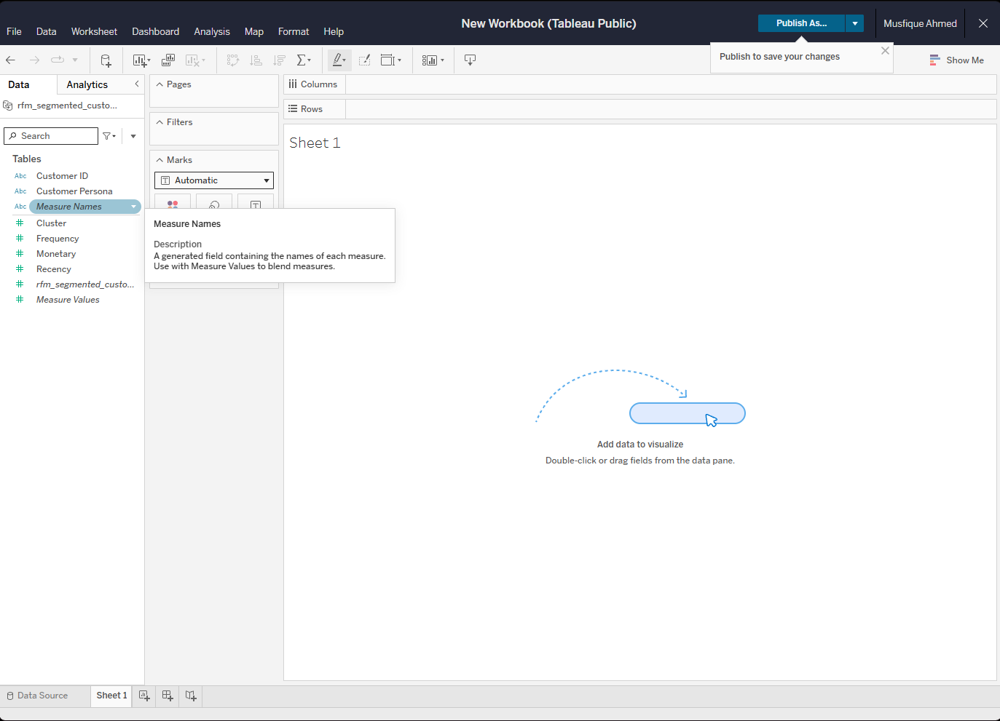

*Figure B3. Tableau worksheet field configuration.*

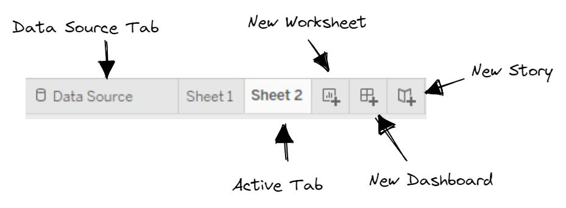

*Figure B4. Tableau workbook worksheet and dashboard navigation tabs.*

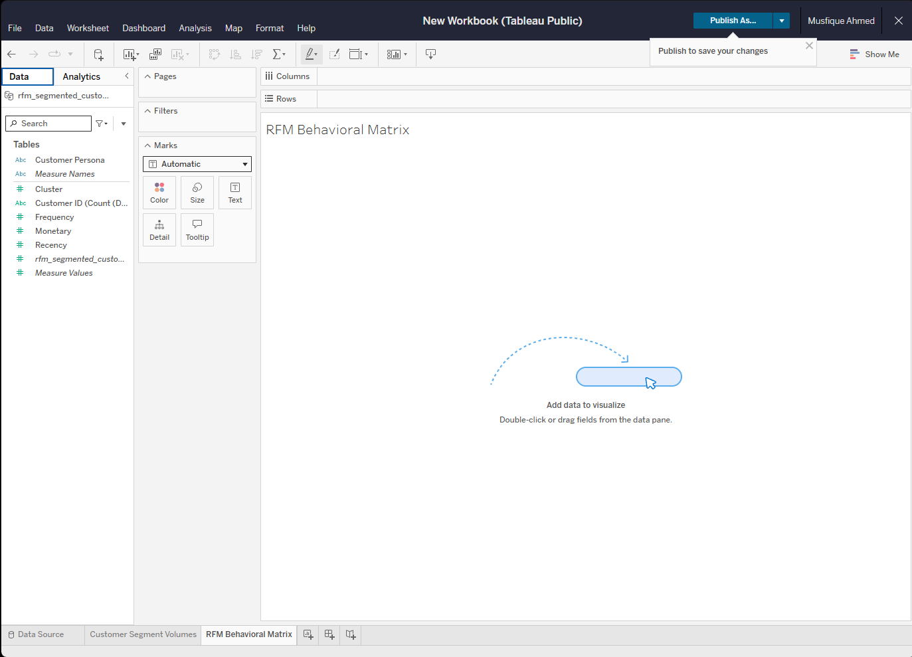

*Figure B5. RFM worksheet setup.*


*Figure B6. RFM behavioral matrix worksheet.*


*Figure B7. Recency versus Monetary scatter plot.*

### B.2 Tableau dashboard


*Figure B8. Combined Customer Persona & RFM Analytics Dashboard.*


*Figure B9. Tableau dashboard interaction and publication evidence.*

### B.3 Python and Google Colab implementation


*Figure B10. Python environment setup.*


*Figure B11. Synthetic transaction data generation.*


*Figure B12. RFM feature engineering and aggregation.*


*Figure B13. RFM data inspection and descriptive statistics.*


*Figure B14. Feature standardization.*


*Figure B15. K-Means cluster assignment.*


*Figure B16. Cluster-level RFM summary.*


*Figure B17. Python customer segmentation scatter plot.*


*Figure B18. Customer persona mapping.*


*Figure B19. Customer persona count verification.*

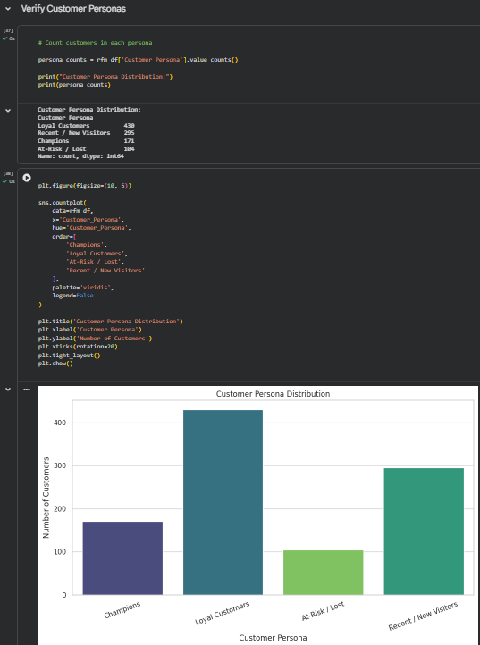

*Figure B20. Customer persona distribution chart.*

---

**End of Report**
